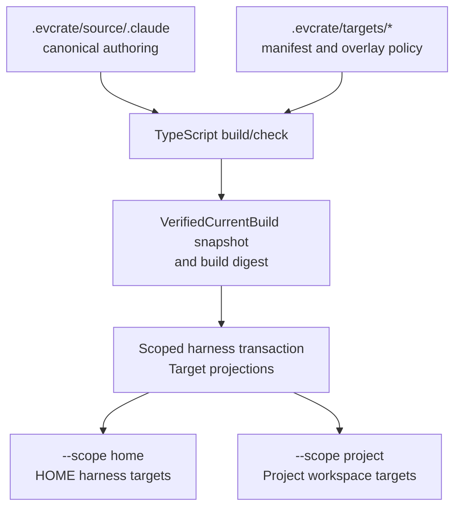

# System Architecture

**Baseline:** `evcrate@3.0.0` (private Node/TypeScript package, Node `>=22.19.0`).
**Target Topology:** `3.0.0` (stable on `main`).
**Status:** Core architecture for the completed advisor subsystem retirement and 7-target harness-only cutover; live vendor/native-host qualification remains separate.
**Windows support:** Standalone installer lifecycle and clean-install `version --json` only. Prior candidate results do not qualify the current package.
**Updated:** 2026-10-13

**Authority:** TypeScript control plane and canonical harness resources.

This document is the central authority for distribution, wire contracts, context
admission, isolation, and publication. The [codebase summary](./codebase-summary.md)
provides the source map; the [project overview and PDR](./project-overview-pdr.md)
turns these contracts into requirements.
## Advisor subsystem retirement boundary

**Status:** Completed in repository cutover (2026-10-11); live vendor/native-host qualification remains separate.
The advisor subsystem, `advisory-interview.md`, `plan-progress.md`, and `/evc-cmd-advise`
are retired across all 69 canonical commands. Preserve generic JSON/resource/publication
contracts, target context/privacy guards, user-owned settings/history/state, and immutable historical records.
BuildManifest v3, publication journal v4/marker v3, release metadata v2, and native
context versions follow the approved advisor subsystem retirement interface freeze
and retirement design contracts.
Strict historical recovery remains bounded; ordinary harness publication leaves
installed `.evcrate/bin` and user data untouched. No cleanup CLI, receipt/index,
process scanner, or migration guide is added.

## 1. System shape

EVCrate is a private npm package (`evcrate`, version `3.0.0`) for building and
publishing one canonical agent-harness source tree into seven persisted target
projections (`claude`, `codex`, `antigravity`, `pi`, `omp`, `copilot`, and `vscode`).
Node `>=22.19.0` is the package engine. Its single npm CLI binary is
`evcrate` → `dist/cli/evcrate.js`.
The control plane resolves an immutable invocation context, validates one request,
dispatches one operation, writes one result, and exits. It does not run a daemon,
listener, background broker, or provider router.

## 2. Ownership and generated boundaries

| Area | Owner | Editing rule |
|---|---|---|
| Canonical harness resources | `.evcrate/source/.claude/` | Author 140 resources: 17 agents, 70 commands, 13 hooks, 34 skills, 6 workflows. Do not hand-edit projections. |
| Target policy | `.evcrate/targets/*/manifest.json` and declared overlays | Change policy/overlays, then rebuild. |
| Generated projections | `.evcrate/source/.claude-projection`, `.agents/skills`, `.codex`, `.antigravity`, `.pi`, `.omp`, `.copilot`, `.evcrate-vscode`, and declared native project documents | Generated output; never hand-edit. |
| Resource registry | `.evcrate/registry.json` | Schema-2 resource records; separate from schema-2 target definitions and schema-3 build manifests. |

The target registry persists seven targets: `claude`, `codex`, `antigravity`,
`pi`, `omp`, `copilot`, and `vscode`. `agy` is an input alias for `antigravity`,
never persisted. Standalone Gemini is retired; Gemini model names and
Antigravity's vendor HOME directory are not retired target selectors.
Projection registration is fixed and exhaustive, with no fallback adapter.

Historical schema-1 and complete eight-target schema-2 resource registries are
validated and normalized read-only: remove Gemini; schema 1 also adds VS Code.
Current writes contain only current targets and retain original-byte CAS.

### Instruction authority and native delivery

`.evcrate/source/.claude/AGENTS.md` is the sole authoring document and an internal
resource-graph entry. Build hashes and snapshot drift bind that file, never the
generated Codex root document. Local Claude output uses `.claude-projection`;
its logical manifest/publication root remains `.claude`, so building cannot
replace the canonical authoring tree.

| Target | Project instructions | HOME instructions | Loader |
|---|---|---|---|
| Claude | `.claude/rules/AGENTS.md` | `~/.claude/rules/AGENTS.md` | Native rules; no direct AGENTS copy or shim |
| Codex | `AGENTS.md` | `~/.codex/AGENTS.md` | Native instruction chain; sole project-root owner |
| Copilot | `.github/copilot-instructions.md` | `~/.copilot/copilot-instructions.md` | Native CLI instructions |
| VS Code Local | `.evcrate-vscode/com.github.copilot/rules/bootstrap.instructions.md` | Same path under HOME | User-registered local plugin |
| OMP | `.omp/evcrate/AGENTS.md` | `~/.omp/agent/evcrate/AGENTS.md` | Installed-root context bridge |
| Pi | `.pi/agent/evcrate/AGENTS.md` | Same path under HOME | Installed extension and child-context bridge |
| Antigravity | `.agents/rules/evcrate-antigravity.md` includes `.antigravity/AGENTS.md` | `~/.gemini/config/AGENTS.md` | Native always-on rule / global standalone rule |

OMP/Pi read bounded, nonempty UTF-8 payloads without symlink traversal; main
contexts deliver once, then rebuild after compaction. When the OMP payload is
unavailable or unsafe, OMP emits a warning and continues without blocking input
or aborting provider requests.
Pi consumes unsafe input; its child launch reads the installed payload before
dispatch. A working-directory document is never a fallback.
Pi marks startup-bearing messages separately from prompt reminders. When
compaction retains an earlier startup message, outgoing context supersedes
only that startup content; reminders, user/other-extension instructions, and
session history remain intact. Failed rebuilds still require a fresh safe read.

Help helpers resolve their installed target and command catalog from adjacent
`scanner-layout.json`, not the caller's working directory. Declared adapter inputs
cover each adapter's transitive `dist/adapters/**` module family, including shared
transforms and VS Code helpers. All seven targets share `advise-inline/v1` semantics.

Antigravity project hooks are leaf-owned `.agents/hooks.json`, using named
`PreInvocation` handlers and `PreToolUse` matcher groups. Canonical session-init
runs only at zero-indexed `invocationNum=0`; reminders return
`injectSteps[].ephemeralMessage`. The bridge verifies but does not reinject the
instruction body. Resume/compact/clear, SubagentStart, SessionEnd, and canonical
PostToolUse context semantics have no qualified native equivalent. HOME command
relocation is structured; `~/.gemini` itself is never owned or deleted.

Mixed installs need user-controlled loader profiles. Claude's `claude-md`
project-instructions profile keeps rules while skipping Codex root AGENTS;
project `pluginConfigs` cannot set it. OMP can disable foreign context providers;
Pi's `--no-context-files` isolates its extension. Copilot natively co-loads root
AGENTS/GEMINI documents in mixed workspaces; `--no-custom-instructions` disables
all custom instructions, not just foreign ones. Respect Codex overrides/custom
HOME, native byte limits, disabled settings sources, and managed-only policies.
Generated-file/runtime bridge checks do not establish native qualification.
Unavailable GUI/native hosts and current model access remain explicit evidence gaps.

`vscode` projects an isolated Agent Plugins 1.0 bundle at `.evcrate/source/.evcrate-vscode/`; `plugin.json` declares `"name": "evc"` (formerly `evcrate-local`) and canonical `evc-cmd-*` commands project to container-local `.evcrate-vscode/skills/cmd-*/SKILL.md`.
Default publication is inert and never mutates editor settings; explicit opt-in registration
(`--register-vscode-settings` or interactive first-time TTY prompt; suppressed by
`--no-register-vscode-settings`) surgically updates `chat.pluginLocations` in workspace or
User `settings.json`, while `evcrate recover` repairs only published artifacts and never
touches editor settings or agent-authored docs. Copilot CLI (`copilot`) and VS Code Local
(`vscode`) are distinct targets with separate formats, hook protocols, and runtime lifecycles.
In `src/adapters/vscode/metadata-tools.ts`,
`mapAgentTools` projects canonical tool intent to pinned VS Code `1.140.0` / Copilot Chat
`0.68.0` frontmatter references (`read/readFile`, `search/fileSearch`, `search/textSearch`,
`search/listDirectory`, `runInTerminal`, `getTerminalOutput`, `killTerminal`,
`agent/runSubagent`, `todo`, `editFiles`, `createFile`, `multiReplaceString`, `web/fetch`,
`edit/editNotebook`; `WebSearch` stays dropped) without broad groups, runtime discovery, or
extra extensions. It preserves `tools: []` deny-all, omitted-tool inheritance, `Task`-derived
`canDelegate` (`agents: ['*']` vs. leaf `agents: []`), and direct `todo`, while keeping
frontmatter references distinct from model-facing names and hook operands (`filePath`, search
`includePattern`/glob roots, notebook `filePath`/`editType`/`cellId`, and `web/fetch` HTTP(S) `urls`/`query` normalized in `tool-inputs.ts` and `runtime-sources.ts`). `evcrate/agent-tool-audit.json`
records build declarations, not effective host grants.

The plugin supplies the command namespace: canonical `evc-cmd-*` commands project to
`.evcrate-vscode/skills/cmd-*/SKILL.md`, retaining `-x-` nesting. Copilot Chat displays
`evc cmd-*` and qualifies skills as `/<plugin-name>:<skill-name>` → `/evc:cmd-*`,
without duplicating `evc` in the local skill name. `src/adapters/vscode/names.ts`
records local `/cmd-*` invocations; `replaceCommandInvocations` in
`src/adapters/vscode/references.ts` rewrites `/evc-cmd-*` and `$evc-cmd-*` to
`/cmd-*` and `$cmd-*`, including wildcard families such as `/evc-cmd-plan-x-*`.
The shared canonical `ev-help.py` scans both `evc-cmd-*/SKILL.md` and `cmd-*/SKILL.md`.

### Proposed VS Code runtime model bindings — planning only

The [runtime-bindings design](../plans/261011-2349-vscode-runtime-model-bindings/design-contracts.md)
and [implementation plan](../plans/261011-2349-vscode-runtime-model-bindings/plan.md)
propose a private companion using proposed `chatPromptFiles`, not a shipped feature
or Marketplace-compatible extension. Native feasibility is the first blocking gate:
provider discovery, direct/subagent model selection, tool/delegation restrictions,
plugin hook attribution, reference resolution and refresh must be observed before
removing static actors.

Canonical `evc-*` actors retain Claude tier intent. The proposed VS Code cutover
publishes immutable converted templates/intent instead of simultaneously selectable
static actors. A single companion registration owner derives concrete file resources
under extension storage, outside publication hashes, from user-selected catalog
identities. Actor specificity wins across scopes: a user-default actor override beats
a root tier binding, and a root actor override beats that user override. Canonical
inheritance stays omitted unless explicitly overridden. No inferred newest model, build-time catalog discovery,
or silent static fallback. The `evc` plugin continues owning hooks/skills/workflows;
cross-source attribution remains unqualified until native evidence establishes it.

Required companion qualification is local project/HOME coexistence, multi-root and
profiles only; SSH, dev-container and WSL are outside this deliverable, without
changing unrelated baseline support. Cached agent selections may execute an unintended
model until explicit reselection/reload. Native race and recovery evidence remains
required; refreshed/reselected resources, trust, restrictions and hooks retain hard
correctness gates. Storage remains bounded; measured caps and safe fully closed-editor
manual cleanup are acceptable when automatic reclamation is unproven. Exhaustion
blocks new derivation without deleting possibly referenced resources.

The proposed VSIX is a hashed artifact within the VS Code harness binding, not
new control-plane infrastructure or an eighth core release asset. Installation is
a consented CLI post-action after committed publication, outside transaction rollback.
Editor/profile selection, extension disabled state and proposal enablement are separate
boundaries. No automatic `argv.json` edits, editor restart, all-profile installation,
or advisor-controller resurrection. The existing baseline above remains authoritative
until this pending plan passes its implementation and qualification gates.
Explicitly requested failed or manual-setup-required installation returns exit 5,
preserving committed publication stdout and separate companion-status stderr;
no rollback or blind publication retry. Each live qualification session requires
explicit approval for the exact isolated profile/workspace, selected models and
invocation scope, separate from installation and proposed-API authorization.

### Snyk specialist composition: local porting boundary

Canonical `.claude/agents/snyk-expert.md` orchestrates two canonical task packages: `skills/snyk-fix/` and independently reusable read-only `skills/dependency-upgrade-review/`. Existing resource import, registry and projection adapters own integration; no second generator or routing mechanism is introduced. The sealed standalone `ext/snyk-expert/` authoring snapshot is retained unchanged.

The parent supplies a canonical absolute installed resource root distinct from the target root. The consuming context explicitly reads both entrypoints and all five references; serialized preload metadata is not reference-consumption evidence. Approval stays main-owned and bound to exact proposal/intent, scope and complete current baseline. Missing execution authority stops mutation; prompt instructions and tool lists are not an OS sandbox.

All current local projections include both skill packages. Antigravity intentionally omits the general specialist agent. Codex, Pi, OMP and Copilot omit Claude agent preload/permission metadata. Pi drops the requested web tools; OMP maps `WebFetch` to `read`; Codex tool lists remain migration comments. Copilot namespaces packages and rebases relative Markdown sibling skill links, preserving handoffs from entrypoints and nested references.

Generation, resolved local links and constructed explicit-read procedure behavior are distinct from native child discovery, permission enforcement and live remediation. No all-target parity, production publication or fixed-finding claim follows from local porting. See the [qualification matrix](../plans/261001-0304-claude-snyk-agent-skill-pattern/reports/porting-qualification.md); Phase 05 live qualification remains incomplete.

### Standalone Sonar remediation cycles

The standalone extension `ext/sonarqube-test-quality/` provides neutral domain policy, discovery, scanner lifecycle, cycle-ledger, run-guidance references and templates, portable `sonar-evidence` actor prompt, and the thin `cmd-sonar-remediate` command skill prompt in repository source. No canonical resources, registry/projections, native actor registration or host settings are added.

The consuming host must provide real independent subagents. The parent owns a
global maximum N with persisted failures and bounded corrections; approved native
scanner lifecycles submit actual analyses and correlate every target's task,
analysis, gate and complete findings. Final success requires committed-input
qualification and independent audit, not a passing gate alone. Upload, commit and
push authority remain separate; prompt restrictions are not a sandbox.

The dual-root installer (`lib/install.js`, `bin/install.js`) explicitly selects `.agents/skills/`,
`.claude/skills/`, or both for the 18-asset two-skill payload (`skills/sonarqube-test-quality/`
and `skills/cmd-sonar-remediate/`). Both roots use one guarded in-process publish/rollback
transaction, with shared project-level and legacy agents-lock coordination. This is not
all-file atomic visibility or process-crash recovery. Duplicate host discovery requires
observed path selection, not assumed precedence.
Implementation acceptance uses package/installed-host behavioral evidence and
historical supplied-report guidance, not a mandatory new live Sonar run.
Actual remediation-run server-success claims still require the full evidence
contract above. Ordinary local-only and Jenkins routes remain separate.
Phases 02–08 deliver repository-source discovery, scanner lifecycle, test/coverage verification, cycle-ledger state/budget/evidence policy ([`remediation-cycles.md`](../ext/sonarqube-test-quality/references/remediation-cycles.md)), privacy/redaction and promotion policy ([`run-guidance.md`](../ext/sonarqube-test-quality/references/run-guidance.md)), private ledger/sanitized guidance report templates ([`remediation-cycle-report.md`](../ext/sonarqube-test-quality/templates/remediation-cycle-report.md), [`run-guidance-report.md`](../ext/sonarqube-test-quality/templates/run-guidance-report.md)), portable evidence actor prompt ([`sonar-evidence.md`](../ext/sonarqube-test-quality/agents/sonar-evidence.md)), thin portable command skill prompt ([`cmd-sonar-remediate/SKILL.md`](../ext/sonarqube-test-quality/commands/cmd-sonar-remediate/SKILL.md)), dual-root transactional installer with packaging allowlist (`lib/install.js`, `bin/install.js`, `package.json#files`), and behavioral evals catalog ([`evals/evals.json`](../ext/sonarqube-test-quality/evals/evals.json)) in `ext/sonarqube-test-quality/`, linked from [`remediation-and-handoff.md`](../ext/sonarqube-test-quality/references/remediation-and-handoff.md) while keeping [`report-formats.md`](../ext/sonarqube-test-quality/references/report-formats.md) JSON-authoritative over converted Markdown views. Historical report lessons and offline package/install smoke are reviewed, while live host execution and live server qualification remain separate unexercised boundaries. Planning artifacts remain local and Git-ignored.
## 3. TypeScript control plane

The source is organized around narrow contracts:

- `src/protocol/`: bounded JSON, canonical JSON, resource, publication, and scope
  wire shapes.
- `src/context/`: package, project, home, state, target, and immutable path context.
- `src/manifests/`: schema-2 target manifests, resource roots, home bindings,
  patch authorization, and manifest registry loading.
- `src/adapters/`: seven target projection adapters (six shared-registry adapters plus the
  VS Code Local native adapter in `src/adapters/vscode/`), resource graph validation,
  qualification, and target-specific transforms.
- `src/registry/`: schema-2 canonical resource scan, strict historical compatibility
  records, and deterministic queries.
- `src/imports/`: bounded explicit-source preview/apply and single-use replay tokens.
- `src/scopes/`: global/project assignments, inheritance, revisions, and CAS.
- `src/distribution/`: local build/check, schema-3 build verification, staging,
  publication, recovery, managed JSON/JSONC, Pi settings, and cutover gates.
- `src/cli/`: argument parsing, request-file handling, dispatch, process runner,
  output, and the executable wrapper.
- `src/filesystem/` and `src/errors/`: bounded paths/I/O/hashes/locks/atomicity and
  stable sanitized errors.

The CLI accepts `version`, `resources list|get`, `imports preview|apply`,
`scopes list|get|assign|remove|enable|disable`, `changes preview|apply`,
and distribution `build|check|publish|all|recover`.
A complete bounded versioned request file is mutually exclusive with positional
command construction. JSON and non-TTY output use the same validated result.

### Host-native context paths

Invocation context uses a strict host/portable path boundary:

- `safePath` and `resolveSafePath` validate host-native absolute roots. On Windows,
  `validateWindowsPath` accepts drive-rooted paths and emits native separators,
  while rejecting drive-relative, UNC/device, traversal, duplicate, ADS, invalid
  character, trailing dot/space, DOS-device, metadata, and sensitive segments.
- `normalizeRelativePath` remains the authority for relative POSIX metadata in
  manifests, archives, inventories, and receipts; Windows handling does not
  broaden those identities.
- `assertNoSymlinkAncestors` is the shared ancestor guard. It walks from
  `parse(resolve(value)).root` with the host `sep`, stops only at missing
  components, and fails closed for other filesystem errors. `path-resolution.ts`
  reuses it instead of maintaining a private walker.
- Context still resolves before request loading and dispatch; `version --json` has
  no context bypass. Focused context/CLI fixtures derive roots from file URLs,
  and package smoke uses ComSpec to invoke `.cmd` through Windows command dispatch.
  Phase 09 integrated qualification plus Phase 10 support cutover qualify the
  standalone installer lifecycle and clean-install verification across the
  supported Windows matrix; broader Windows runtime equivalence remains excluded.

## 4. Build, hash, and publication

A local build stages canonical resources and selected projections outside live roots.
Strict BuildManifest v3 contains exactly `schema_version`, `source_hashes`,
`adapter_hashes`, `owners`, `output_hashes`, `validation`, and `home_policy`.
Owners/output hashes cover only harness output. Aggregate policies cover all seven
targets; per-target manifests cover their selected policy/output view.
Validation retains only `complete: true`, `symlinks: "rejected"`, and
`target_registry: "validated"`. Target definitions and resource registry stay schema 2.
Old active build artifacts reject with `PROTOCOL_INVALID` and regenerate/rebuild
guidance. Resource-file identity remains domain-separated from directory-tree
identity; generic `hashFile` is raw byte SHA-256.

Build/check, publication, and recovery are separate. One verified build
snapshot/digest feeds a single harness transaction in scalar `--scope home|project`
(default `home`); `--target` selects projections, not additional infrastructure.

1. **Harness destinations**:
   - HOME bindings come from target manifests beneath `--home` in `PUBLICATION_BINDING_ORDER`
     (`.agents/skills`, `.codex`, `.pi`, `.gemini/config`, `.omp`, `.claude`, `.copilot`, `.evcrate-vscode`,
     without `.evcrate/bin`). Codex owns `.agents/skills` and `.codex/AGENTS.md`; Antigravity maps to
     `.gemini/config`, never its vendor parent. Native leaf ownership preserves unrelated siblings.
   - Project output binds only under the approved canonical `--project-root`,
     in deterministic declared order. Installed wrappers resolve resources from
     their installation location, not project cwd. Runtime cwd is task context.
     Explicit session context retains atomic CAS v1 and bounded retention
     (7d, 256/project, 1024/user) with `set-active-plan.cjs`.
2. **Transaction and safety**:
   - Acquire only scope-derived harness locks and stage on the destination volume.
     Reject unsafe ancestors, wrong kinds, containment escapes, overlaps,
     unmanaged collisions, changed object/byte identities, and cross-volume promotion.
   - Journal v4 uses `transaction_type: "target-publication"`,
     `logical_phase: "harness"`, and exactly `records: {harness}`. Capture actual
     workspace device/inode/parent identity before the first staged journal, then
     persist that complete journal before destination mutation.
   - Marker v3 has exact keys `schema_version`, `transaction_type`, `scope`,
     `records`, with exactly `{harness}`. `readReleaseMarker` and `writeReleaseMarker`
     (`src/filesystem/locking.ts`) support `schema_version` `1`, `2`, and `3` (`1 | 2 | 3`).
     Carry forward only validated prior harness ownership, preserving unselected owned targets.
   - Operations remain strict file operations with snapshot, backup, digest,
     progress, intended/promoted consistency, and CAS checks. Optional
     `cleanup: "retired-binding"` remains exact predecessor-owned harness-file
     pruning, never whole-directory deletion.
3. **Public results and failures**:
   - Success/dry-run uses the existing resource-control v1 publication envelope
     with one harness phase. Successful apply has `status: "committed"` and real
     release identity; project `retainedReleaseId` is null.
   - Failures use the ordinary `status: "error"` envelope with exactly
     `protocol`, `protocolVersion`, `requestId`, `operation`, `status`, `error`.
     No publication payload or fabricated phase/release identity. Preserve conflict
     envelopes and original error codes. `PUBLICATION_FAILED`/`ROLLBACK_FAILED`
     remain exit 5; failed rollback retains evidence and never claims restoration.
4. **Scope-isolated recovery**:
   - HOME state is `$HOME/.evcrate/publication/`; project state is
     `stateRoot/project-publication/<canonical SHA-256 project identity>`.
     Project state storage grants no HOME publication/lock/recovery authority.
   - Strict admitted journals v1/v2/v3 and markers v1/v2 retain original scope,
     roots, ownership, digest, snapshot, backup, and progress admission.
     `PREDECESSOR_BINDING_ORDER` (`.evcrate/bin`, `.gemini`, `.agents`, `.codex`, `.pi`,
     `.gemini/config`, `.omp`, `.claude`, `.copilot`, `.evcrate-vscode`) retains historical
     bindings for predecessor state admission and recovery, whereas current HOME publication
     uses the eight-binding `PUBLICATION_BINDING_ORDER`. Recover an interrupted transaction
     in its selected scope before ordinary marker conversion. Historical recovery may restore
     transaction-authorized old bytes as data, never execute them. Ordinary publication preserves
     old `.evcrate/bin` and user-owned data without scanning or deleting them.
   - Python-era marker parsing is distinct from recovery: non-target-publication
     active markers still fail closed. Separate existing
     `.evcrate-promotion-journal.json` generic promotion recovery remains supported.
   - Stop agent processes before recovery; no cross-scope search, permissive
     parse fallback, invented provenance, or new transaction type.

Standalone unpack layouts differ by platform: Linux uses
`<data-root>/snapshots/<snapshot>` plus a `<data-root>/current` symlink;
Windows uses `<root>/versions/<snapshot>` plus a `<root>/current.json` pointer
and `<root>/bin/evcrate.cmd`. Publication state is separate from either
installer layout.

The TypeScript engine is authoritative; no root `distribute.py` is canonical.
Publication CAS binds object kind/identity and bytes. The Windows release
candidate and publisher are separate; see
[PDR FR-15](./project-overview-pdr.md#fr-15-canonical-semantic-release-candidate-and-verify-only-publisher).

### 4.1 Single-projection manifest reuse and bounded worker staging

Full-workspace manifest generation (`scripts/build-manifests.mjs`, `runAllManifestsBuild`) eliminates redundant staging cycles by projecting each persisted target once, supporting serial mode and bounded worker pools (`TargetWorkerPool`, `--jobs <n>`, default 2):

1. **Input Snapshot Isolation**: `prepareInputSnapshot(packageRoot)` stages canonical inputs (`.claude`) and compiled runtime (`dist/**/*.js`). `canonicalInputHash` computes snapshot freshness across all consumed files, including `.gitignore` (projected by Claude); manifest `treeHash` retains its canonical definition excluding `.gitignore`.
2. **Physical Boundary & Traversal Safety**: `visitSnapshotInputs` validates `assertNoSymlinkAncestors` and `assertRealDirectory`. Unsafe entries (symlinks, special files) throw `PATH_UNSAFE` immediately before any filter. Traversal filters (`isIgnoredArtifact`) bypass excluded directories (`node_modules/`, `__pycache__/`) without recursing into descendant paths.
3. **Runtime Revision Binding**: `compiledRuntimeHash` hashes all `.js` files in `dist/`. The parent verifies disk runtime against in-memory `loadedRuntimeHash`; any divergence throws `PUBLICATION_FAILED` across serial and parallel modes. Workers execute the snapshot runtime (`sharedInputs.runtimeRoot/distribution/target-worker.js`).
4. **Adapter Hash Closures & URL Restoration**: All six translated targets (`antigravity`, `codex`, `copilot`, `omp`, `pi`, `vscode`) declare their transitive `dist/adapters/**` helper closure, including `dist/adapters/uri-restoration.js`, in `adapter_sources`. Codex `applyReplacements` uses a linear regex callback for literal URL restoration, preserving template sequences (`$&`, `$$`) without cascading substitution.
5. **In-Memory Metadata Derivation**: `deriveManifestView` derives metadata for all seven targets plus the aggregate manifest entirely in memory:
   - Aggregate `home_policy` contains exactly seven current target policies; each single-target view contains exactly its selected target policy.
   - Source hashes for `.evcrate/targets` are included only in the aggregate manifest and omitted from single-target manifests.
   - All eight manifests (`build-manifest.json` and seven `build-manifest-<target>.json`) are written atomically into stage (`writeAtomicFile`).
6. **Promotion Freshness & Atomic Promotion**: In `promoteUnlocked`, `options.hooks?.beforeTransaction?.()` verifies live input freshness (`assertLiveInputsUnchanged`) under the promotion lock, strictly BEFORE writing the journal or claiming destination outputs. Source drift aborts safely before journal recording, avoiding `ROLLBACK_FAILED`. Promotion commits all eight manifests and outputs in a single atomic transaction (`promoteTransaction`).
7. **Verified Return Envelope & Benchmark Metric**: `runAllManifestsBuild` returns `VerifiedAllManifestsBuild` containing `aggregateBuild`, `targetBuilds`, and `allManifestPaths`. Benchmark harness (`scripts/benchmark-build-generation.mjs`) reports post-build parent process RSS (`memoryUsage().rss`), not worker process-tree peak.
### 4.2 Release workflow trust boundary (Phases 07–10)
`.github/workflows/release.yml` implements `release-candidate` → `publish`.
- The producer is read-only/non-canceling, keeps Ubuntu/Node 24.21.0 gates, uploads
  only for `has_release=true`, and routes bytes by exact `artifact_id`.
- `publish` is the sole writer after `release-candidate` success, checks out the producer SHA,
  copies the release candidate assets, re-verifies receipt/hash/run identity, and
  checks the exact seven core release files. It does not install the plugin SDK,
  build a plugin package, or attach plugin tarballs.
- Phase 09 proved integrated routing and final seven-file byte equality; Phase 10
  completed the bounded documentation/support cutover.

### 4.3 Unprivileged Windows PR smoke (Phase 08)
`.github/workflows/windows-smoke.yml` triggers only `pull_request` and manual dispatch; `contents: read` plus canceling concurrency keep PR execution unprivileged.
- On `windows-2025` x64 with Node `24.21.0` and PowerShell 7 (`pwsh.exe`), it runs `npm ci` after pinned checkout/setup-node actions.
- It reads the checked-in version and current 40-hex SHA, builds diagnostic fixture assets with `--allow-fixture-identity`, verifies exact-seven files, and invokes the same smoke harness with explicit `--powershell pwsh.exe`.
- It has no secrets, write scope, upload, semantic-release, privileged follow-up, or release handoff; status is diagnostic only.
- `.releaserc.json` uses exact post-qualification labels `Windows x64 Archive` and `Windows Installer Entrypoint (install.ps1)`; other asset paths/labels and prepare authority remain unchanged.
- `tests/distribution/release-orchestration.test.mjs` covers WRQ-042 (workflow boundary), WRQ-043 (fixture/verify/smoke), and WRQ-044 (labels/preserved config).

## 5. Native command context

OMP admission uses installed-module resources and an existing absolute project cwd.
Its `evcrate_omp_command_context` header v3 contains exactly `protocol`, `version`,
`source: "native-user"`, `command`, and `context`. Context has exact keys
`project_root`, `command`, `work_target`, `plan_path`, `phase_path`, `phase_id`;
the last three are null unless explicitly validated by the caller. Command templates
and mandatory workflow/documentation resources must come from the same installed root.
Missing raw string, cwd, or resources stops before admission with a bounded,
privacy-safe notice. Raw `$ARGUMENTS` appears once; positional substitution remains.

Pi uses `evcrate-pi-command-context` v2 with exact `protocol`, `version`, `source`,
`command`, `raw_arguments`; source is `native-user` or `model-tool`. Preserve nested
depth/count/cycle bounds, allowed-tool policy, child-start hook timing,
installed-root containment, and privacy/scout hooks.

### Normative command and resource naming convention

Canonical commands are authored as flat files (`commands/evc-cmd-<segment>(-x-<segment>)*.md`)
and agents as `agents/evc-<agent>.md`, governed by `src/adapters/resource-naming.ts` and
enforced by `.evcrate/source/.claude/scripts/scan_commands.py`:

- Canonical and non-VS Code slash command forms use `/evc-cmd-*` (e.g., `/evc-cmd-code`, `/evc-cmd-cook`, `/evc-cmd-fix`). VS Code Local uses `/cmd-*` inside plugin `evc`, with host-qualified `/evc:cmd-*` invocation; the colon is host syntax, not part of a resource name.
- Nested commands use reserved `-x-` path separator (e.g., `/evc-cmd-fix-x-hard`), reversible to semantic IDs (`fix/hard`).
- Agents use `evc-*` (e.g., `evc-planner`, `evc-code-reviewer`). Copilot skills use `evc-<skill>` and styles use `evc-style-<style>`.
- Specification: charset `^[a-z0-9]+(-[a-z0-9]+)*$`, length <= 64, no `_`, `:`, `--`. Semantic command IDs (`code/auto`) remain stable.
- Canonical target instructions are authored solely in `.evcrate/source/.claude/AGENTS.md`; `.evcrate/source/AGENTS.md` is generated Codex output.
- Pre-upgrade ownership: stale recorded-owned harness files are pruned; untracked legacy leftovers are preserved/reported; unmanaged collisions refuse publication. Current schema-4 journals retain file-only `cleanup: "retired-binding"` for exact predecessor-owned paths. Historical journal v1/v2/v3 admission remains strict.
- Release topology: canonical branch `main` (`3.0.0`); candidate builds run against a disposable local bare mirror and verify `candidate.json` and exact-seven asset digests in `publish-release.cjs` before publishing on `main` (prerelease candidates are retired; Windows qualification runs in PRs via `.github/workflows/windows-smoke.yml`). See [release candidate and publication verification](./code-standards.md#release-candidate-and-publication-verification).
## 6. Verification and support boundary

Repository build, regeneration, Linux installer lifecycle/verification, and automated
test gates are exercised for this cutover; live vendor/GUI and native Windows host
qualification remain separate. Historical counts and generated resources are not live
vendor acceptance evidence. Qualification preserves generic JSON/resource/import/scope,
path/privacy, publication CAS/locking/rollback/recovery, and seven-target native-context boundaries.

Release metadata writes `evcrate-private-release/v2` with exact release fields
excluding the former `controller_closure_digest`. Archive/platform/installer
validation remains strict; installer receipts (`evcrate-installer-receipt/v1`) and
current pointers (`evcrate-current-pointer/v1`) stay v1. Both `install.sh` and
`install.ps1` enforce predecessor snapshot containment and non-symlink/non-reparse
ancestry during `repair`, and require current v2 packages to expose only
`evcrate -> dist/cli/evcrate.js` in `package.json#bin`. Current v2 asset `repair`
repairs missing or corrupted `installer-receipt.json` files without reading predecessor
receipt contents; historical v1 (`evcrate-private-release/v1`) `repair` requires a
regular non-symlink/non-reparse `installer-receipt.json` matching `snapshot_id`,
`version`, `archive_name`, `archive_sha256`, and `inventory_digest`. Fresh installation
requires current v2 assets.

Windows support remains standalone installer lifecycle and `version --json` on
the matching hosted x64 matrix, not broad Windows runtime parity. GUI/native
host availability, model access, and safe report-writing capability must be
reported explicitly; unavailable rows remain unqualified.

## Related documents

- [Agent guidance](../AGENTS.md)
- [Project overview and PDR](./project-overview-pdr.md)
- [Code standards](./code-standards.md)
- [Codebase summary](./codebase-summary.md)
- [Project roadmap](./project-roadmap.md)
- [Project changelog](./project-changelog.md)
- [Project changelog archive](./project-changelog-archive.md)
- [Pi-native migration](./pi-native-migration.md)
- [Snyk specialist guide](./snyk-expert-cli.md)
- [Pre-Upgrade Backup & Leftover Guidance](./upgrade-backup-and-leftover-guidance.md)
