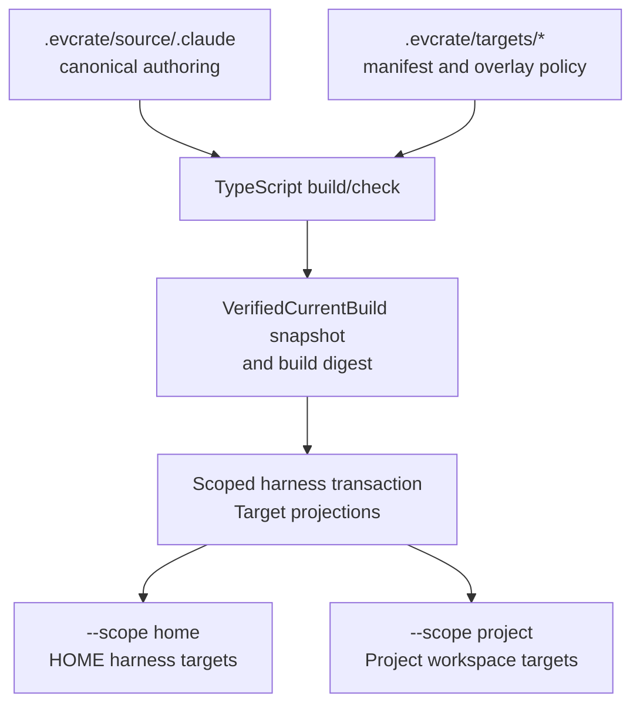

# System Architecture

**Baseline:** `evcrate@3.0.0` (private Node/TypeScript package, Node `>=22.19.0`).
**Target Topology:** `3.0.0` (stable on `main`).
**Status:** Core architecture for the completed advisor subsystem retirement and 7-target harness-only cutover; Phase 09 records integrated companion qualification and isolated Windows host checks, while interactive Copilot Chat qualification remains blocked.
**Windows support:** Standalone installer lifecycle and clean-install `version --json` remain the general package boundary. Phase 09 qualifies only the isolated companion scenarios recorded below, not broad Windows runtime parity.
**Updated:** 2026-10-13

**Authority:** TypeScript control plane and canonical harness resources.

This document is the central authority for distribution, wire contracts, context
admission, isolation, and publication. The [codebase summary](./codebase-summary.md)
provides the source map; the [project overview and PDR](./project-overview-pdr.md)
turns these contracts into requirements.
## Advisor subsystem retirement boundary

**Status:** Completed in repository cutover (2026-10-11); live vendor/native-host qualification remains separate.
The advisor subsystem, `advisory-interview.md`, `plan-progress.md`, and `/evc-cmd-advise`
are retired across all 69 canonical commands. Preserve generic JSON/resource/publication
contracts, target context/privacy guards, user-owned settings/history/state, and immutable historical records.
BuildManifest v3, publication journal v4/marker v3, release metadata v2, and native
context versions follow the approved advisor subsystem retirement interface freeze
and retirement design contracts.
Strict historical recovery remains bounded; ordinary harness publication leaves
installed `.evcrate/bin` and user data untouched. No cleanup CLI, receipt/index,
process scanner, or migration guide is added.

## 1. System shape

EVCrate is a private npm package (`evcrate`, version `3.0.0`) for building and
publishing one canonical agent-harness source tree into seven persisted target
projections (`claude`, `codex`, `antigravity`, `pi`, `omp`, `copilot`, and `vscode`).
Node `>=22.19.0` is the package engine. Its single npm CLI binary is
`evcrate` → `dist/cli/evcrate.js`.
The control plane resolves an immutable invocation context, validates one request,
dispatches one operation, writes one result, and exits. It does not run a daemon,
listener, background broker, or provider router.

## 2. Ownership and generated boundaries

| Area | Owner | Editing rule |
|---|---|---|
| Canonical harness resources | `.evcrate/source/.claude/` | Author 140 resources: 17 agents, 70 commands, 13 hooks, 34 skills, 6 workflows. Do not hand-edit projections. |
| Target policy | `.evcrate/targets/*/manifest.json` and declared overlays | Change policy/overlays, then rebuild. |
| Generated projections | `.evcrate/source/.claude-projection`, `.agents/skills`, `.codex`, `.antigravity`, `.pi`, `.omp`, `.copilot`, `.evcrate-vscode`, and declared native project documents | Generated output; never hand-edit. |
| Resource registry | `.evcrate/registry.json` | Schema-2 resource records; separate from schema-2 target definitions and schema-3 build manifests. |

The target registry persists seven targets: `claude`, `codex`, `antigravity`,
`pi`, `omp`, `copilot`, and `vscode`. `agy` is an input alias for `antigravity`,
never persisted. Standalone Gemini is retired; Gemini model names and
Antigravity's vendor HOME directory are not retired target selectors.
Projection registration is fixed and exhaustive, with no fallback adapter.

Historical schema-1 and complete eight-target schema-2 resource registries are
validated and normalized read-only: remove Gemini; schema 1 also adds VS Code.
Current writes contain only current targets and retain original-byte CAS.

### Instruction authority and native delivery

`.evcrate/source/.claude/AGENTS.md` is the sole authoring document and an internal
resource-graph entry. Build hashes and snapshot drift bind that file, never the
generated Codex root document. Local Claude output uses `.claude-projection`;
its logical manifest/publication root remains `.claude`, so building cannot
replace the canonical authoring tree.

| Target | Project instructions | HOME instructions | Loader |
|---|---|---|---|
| Claude | `.claude/rules/AGENTS.md` | `~/.claude/rules/AGENTS.md` | Native rules; no direct AGENTS copy or shim |
| Codex | `AGENTS.md` | `~/.codex/AGENTS.md` | Native instruction chain; sole project-root owner |
| Copilot | `.github/copilot-instructions.md` | `~/.copilot/copilot-instructions.md` | Native CLI instructions |
| VS Code Local | `.evcrate-vscode/com.github.copilot/rules/bootstrap.instructions.md` | Same path under HOME | User-registered local plugin |
| OMP | `.omp/evcrate/AGENTS.md` | `~/.omp/agent/evcrate/AGENTS.md` | Installed-root context bridge |
| Pi | `.pi/agent/evcrate/AGENTS.md` | Same path under HOME | Installed extension and child-context bridge |
| Antigravity | `.agents/rules/evcrate-antigravity.md` includes `.antigravity/AGENTS.md` | `~/.gemini/config/AGENTS.md` | Native always-on rule / global standalone rule |

OMP/Pi read bounded, nonempty UTF-8 payloads without symlink traversal; main
contexts deliver once, then rebuild after compaction. When the OMP payload is
unavailable or unsafe, OMP emits a warning and continues without blocking input
or aborting provider requests.
Pi consumes unsafe input; its child launch reads the installed payload before
dispatch. A working-directory document is never a fallback.
Pi marks startup-bearing messages separately from prompt reminders. When
compaction retains an earlier startup message, outgoing context supersedes
only that startup content; reminders, user/other-extension instructions, and
session history remain intact. Failed rebuilds still require a fresh safe read.

Help helpers resolve their installed target and command catalog from adjacent
`scanner-layout.json`, not the caller's working directory. Declared adapter inputs
cover each adapter's transitive `dist/adapters/**` module family, including shared
transforms and VS Code helpers. All seven targets share `advise-inline/v1` semantics.

Antigravity project hooks are leaf-owned `.agents/hooks.json`, using named
`PreInvocation` handlers and `PreToolUse` matcher groups. Canonical session-init
runs only at zero-indexed `invocationNum=0`; reminders return
`injectSteps[].ephemeralMessage`. The bridge verifies but does not reinject the
instruction body. Resume/compact/clear, SubagentStart, SessionEnd, and canonical
PostToolUse context semantics have no qualified native equivalent. HOME command
relocation is structured; `~/.gemini` itself is never owned or deleted.

Mixed installs need user-controlled loader profiles. Claude's `claude-md`
project-instructions profile keeps rules while skipping Codex root AGENTS;
project `pluginConfigs` cannot set it. OMP can disable foreign context providers;
Pi's `--no-context-files` isolates its extension. Copilot natively co-loads root
AGENTS/GEMINI documents in mixed workspaces; `--no-custom-instructions` disables
all custom instructions, not just foreign ones. Respect Codex overrides/custom
HOME, native byte limits, disabled settings sources, and managed-only policies.
Generated-file/runtime bridge checks do not establish native qualification.
Unavailable GUI/native hosts and current model access remain explicit evidence gaps.

`vscode` projects an isolated Agent Plugins 1.0 bundle at `.evcrate/source/.evcrate-vscode/`; `plugin.json` declares `"name": "evc"` (formerly `evcrate-local`) and canonical `evc-cmd-*` commands project to container-local `.evcrate-vscode/skills/cmd-*/SKILL.md`.
Default publication is inert and never mutates editor settings; explicit opt-in registration
(`--register-vscode-settings` or interactive first-time TTY prompt; suppressed by
`--no-register-vscode-settings`) surgically updates `chat.pluginLocations` in workspace or
User `settings.json`, while `evcrate recover` repairs only published artifacts and never
touches editor settings or agent-authored docs. Copilot CLI (`copilot`) and VS Code Local
(`vscode`) are distinct targets with separate formats, hook protocols, and runtime lifecycles.
In `src/adapters/vscode/metadata-tools.ts`,
`mapAgentTools` projects canonical tool intent to pinned VS Code `1.140.0` / Copilot Chat
`0.68.0` frontmatter references (`read/readFile`, `search/fileSearch`, `search/textSearch`,
`search/listDirectory`, `execute/runInTerminal`, `execute/getTerminalOutput`, `execute/killTerminal`,
`agent/runSubagent`, `todo`, `editFiles`, `createFile`, `multiReplaceString`, `web/fetch`,
`edit/editNotebook`; `WebSearch` stays dropped) without broad groups, runtime discovery, or
extra extensions. It preserves `tools: []` deny-all, omitted-tool inheritance, `Task`-derived
`canDelegate` (`agents: ['*']` vs. leaf `agents: []`), and direct `todo`, while keeping
frontmatter references distinct from model-facing names and hook operands (`filePath`, search
`includePattern`/glob roots, notebook `filePath`/`editType`/`cellId`, and `web/fetch` HTTP(S) `urls`/`query` normalized in `tool-inputs.ts` and `runtime-sources.ts`). `evcrate/agent-tool-audit.json`
records build declarations, not effective host grants.

The plugin supplies the command namespace: canonical `evc-cmd-*` commands project to
`.evcrate-vscode/skills/cmd-*/SKILL.md`, retaining `-x-` nesting. Copilot Chat displays
`evc cmd-*` and qualifies skills as `/<plugin-name>:<skill-name>` → `/evc:cmd-*`,
without duplicating `evc` in the local skill name. `src/adapters/vscode/names.ts`
records local `/cmd-*` invocations; `replaceCommandInvocations` in
`src/adapters/vscode/references.ts` rewrites `/evc-cmd-*` and `$evc-cmd-*` to
`/cmd-*` and `$cmd-*`, including wildcard families such as `/evc-cmd-plan-x-*`.
The shared canonical `ev-help.py` scans both `evc-cmd-*/SKILL.md` and `cmd-*/SKILL.md`.

### Proposed VS Code runtime model bindings — planning only

The [runtime-bindings design](../plans/261011-2349-vscode-runtime-model-bindings/design-contracts.md)
and [implementation plan](../plans/261011-2349-vscode-runtime-model-bindings/plan.md)
propose a private companion using proposed `chatPromptFiles`, not a shipped feature
or Marketplace-compatible extension. Native feasibility is the first blocking gate:
provider discovery, direct/subagent model selection, tool/delegation restrictions,
plugin hook attribution, reference resolution and refresh must be observed before
removing static actors.

Canonical `evc-*` actors retain Claude tier intent. The proposed VS Code cutover
publishes immutable converted templates/intent instead of simultaneously selectable
static actors. A single companion registration owner derives concrete file resources
under extension storage, outside publication hashes, from user-selected catalog
identities. Actor specificity wins across scopes: a user-default actor override beats
a root tier binding, and a root actor override beats that user override. Canonical
inheritance stays omitted unless explicitly overridden. No inferred newest model, build-time catalog discovery,
or silent static fallback. The `evc` plugin continues owning hooks/skills/workflows;
cross-source attribution remains unqualified until native evidence establishes it.

Required companion qualification is local project/HOME coexistence, multi-root and
profiles only; SSH, dev-container and WSL are outside this deliverable, without
changing unrelated baseline support. Cached agent selections may execute an unintended
model until explicit reselection/reload. Native race and recovery evidence remains
required; refreshed/reselected resources, trust, restrictions and hooks retain hard
correctness gates. Storage remains bounded; measured caps and safe fully closed-editor
manual cleanup are acceptable when automatic reclamation is unproven. Exhaustion
blocks new derivation without deleting possibly referenced resources.

The proposed VSIX is a hashed artifact within the VS Code harness binding, not
new control-plane infrastructure or an eighth core release asset. Installation is
a consented CLI post-action after committed publication, outside transaction rollback.
Editor/profile selection, extension disabled state and proposal enablement are separate
boundaries. No automatic `argv.json` edits, editor restart, all-profile installation,
or advisor-controller resurrection. The existing baseline above remains authoritative
until this pending plan passes its implementation and qualification gates.
Explicitly requested failed or manual-setup-required installation returns exit 5,
preserving committed publication stdout and separate companion-status stderr;
no rollback or blind publication retry. Each live qualification session requires
explicit approval for the exact isolated profile/workspace, selected models and
invocation scope, separate from installation and proposed-API authorization.

### Snyk specialist composition: local porting boundary

Canonical `.claude/agents/snyk-expert.md` orchestrates two canonical task packages: `skills/snyk-fix/` and independently reusable read-only `skills/dependency-upgrade-review/`. Existing resource import, registry and projection adapters own integration; no second generator or routing mechanism is introduced. The earlier canonical porting baseline remains unchanged while the standalone extension `ext/snyk-expert/` evolves independently.

The parent supplies a canonical absolute installed resource root distinct from the target root. The consuming context explicitly reads both entrypoints and all five references; serialized preload metadata is not reference-consumption evidence. Approval stays main-owned and bound to exact proposal/intent, scope and complete current baseline. Missing execution authority stops mutation; prompt instructions and tool lists are not an OS sandbox.

All current local projections include both skill packages. Antigravity intentionally omits the general specialist agent. Codex, Pi, OMP and Copilot omit Claude agent preload/permission metadata. Pi drops the requested web tools; OMP maps `WebFetch` to `read`; Codex tool lists remain migration comments. Copilot namespaces packages and rebases relative Markdown sibling skill links, preserving handoffs from entrypoints and nested references.

Generation, resolved local links and constructed explicit-read procedure behavior are distinct from native child discovery, permission enforcement and live remediation. No all-target parity, production publication or fixed-finding claim follows from local porting. See the [qualification matrix](../plans/261001-0304-claude-snyk-agent-skill-pattern/reports/porting-qualification.md); Phase 05 live qualification remains incomplete.

### Standalone Snyk remediation cycles — delivered instructions, operationally unqualified

**Status:** Phases 01–06 implementation and Phase 08 documentation/closeout complete (`cmd-snyk-remediate/SKILL.md` coordinator authored, registered in installer inventory across 12 assets, evaluation catalog expanded to 49 scenarios, local integration review approved 9/10, documentation and closeout complete); Phase 07 qualification index delivered at `reports/qualification-index.md` (live operational qualification blocked on operator prerequisites PREREQ-01..03, PREREQ-05, PREREQ-06, PREREQ-08; PREREQ-07 unvalidated); heading retained for inbound anchor compatibility.

The [bounded-cycle plan](../plans/261012-1944-general-snyk-remediation-cycles/plan.md) (local planning reference; ignored artifacts must be preserved for handoff)
targets only `ext/snyk-expert/`; the canonical porting boundary above remains
unchanged. Authored command-style coordinator skill (Phase 04):
`ext/snyk-expert/.agents/skills/cmd-snyk-remediate/SKILL.md` (registered in `ext/snyk-expert/lib/inventory.js` in Phase 05). No executable orchestration runner, canonical command,
registry/projection change, or native host adapter.

Main owns positive maximum N, durable attempt history, human decisions, ledger
reconciliation and real authenticated same-scope Snyk final review. The existing
specialist owns one authorized coherent dependency-owner set and returns local
verification evidence with Snyk verification pending. Existing task skills remain
procedures, not stage-specific workers. Applicable Node/Maven procedures retain
their protections; other managers require a complete supported pre-edit procedure.

Post-review corrections return through exact proposal assessment and authority
gates before applying. Each corrective owner set consumes another attempt before
its first operation capable of changing dependency inputs/resolution state, then requires native graph/consumer
validation and a fresh scan. N never bounds scans or approval dialogs; failures,
rollback and resumed invocations cannot reset or bypass the mutation count.
Required validation failure stops ordinary continuation; recovery requires a
separately bound supported request, never an automatic test repair.

Original source records and duplicate ordered occurrences remain immutable;
each attempt appends observations for every original record. Post-only findings
retain separate provenance. Scan reuse requires complete state/scope/policy and
freshness comparability; terminal review observes the actual unchanged final
state. Installer checks and prose fixtures do not establish live workflow proof.
Installer inventory registration (Phase 05), local integration review and corrections (Phase 06), and documentation and closeout (Phase 08) are complete; live host/model/authenticated-scanner qualification (Phase 07) remains blocked on operator prerequisites.

The [reconciled design contracts](../plans/261012-1944-general-snyk-remediation-cycles/design-contracts.md)
keep supported other-manager execution normal and capture observed procedures
as private learning records. Sanitized candidate recipes remain untrusted
documentation; skill promotion is a separately human-authorized source task,
never automatic installed-skill mutation or prerequisite to finishing remediation.
Default evidence is a private ignored target-contained directory with explicit
main-owned evidence-only write authority, containment/access/coverage checks and
no broad ignored-file exemption from baseline identity. Unsafe storage pauses
artifact-producing execution; no automatic ignore-rule or Snyk-filter changes.
Native registration unavailable → actual host/model explicit-read execution from
the installed bundle is allowed, reported as inline rather than independent review.

Proposed acceptance criteria and 36 acceptance cases (SNYK-001–036, spanning delivery, specification, and operational evidence classes) are defined in the
[acceptance matrix](../plans/261012-1944-general-snyk-remediation-cycles/acceptance-matrix.md),
and required live scanner, target, authentication, and environment conditions are inventoried
in the [qualification prerequisites report](../plans/261012-1944-general-snyk-remediation-cycles/reports/qualification-prerequisites.md).
Phases 01–06 and Phase 08 are complete (contracts and prerequisites in Phase 01, procedure and lossless ledger references in Phase 02, specialist and task-skill cutover in Phase 03, and main-owned 8-stage coordinator `cmd-snyk-remediate/SKILL.md` with Step 8 post-review correction loop and observed procedure learning in Phase 04, inventory registration and 49 evaluation scenarios in Phase 05, local integration review and corrections in Phase 06, and documentation and closeout in Phase 08). Live operational qualification (Phase 07) remains blocked pending operator provision of real targets and scanner credentials.

### Standalone Sonar remediation cycles

The standalone extension `ext/sonarqube-test-quality/` provides neutral domain policy, discovery, scanner lifecycle, single-report contracts, portable `sonar-evidence` actor prompt, and the thin `cmd-sonar-remediate` command skill prompt in repository source. No canonical resources, registry/projections, native actor registration or host settings are added.

The consuming host must provide real independent subagents. The parent owns a
global maximum N with persisted failures and bounded corrections; approved native
scanner lifecycles submit actual analyses and correlate every target's task,
analysis, gate and complete findings. Final success requires committed-input
qualification and independent audit, not a passing gate alone. Upload, commit and
push authority remain separate; prompt restrictions are not a sandbox.

Execution maintains one private `<evidence-destination>/sonar-report.md` initialized once from the 49-line template ([`remediation-cycle-report.md`](../ext/sonarqube-test-quality/templates/remediation-cycle-report.md)) or offline converter (`scripts/convert-sonar-report.mjs`, where the converter creates new files with POSIX mode `0600` and `wx` flag, refusing existing output; manual copies or subsequent parent updates do not inherit converter flags). Sonar API JSON is transient input; no mandatory raw JSON bundle, `resume-checkpoint.json`, YAML mirror, separate actor report, or per-cycle file. Native build logs, coverage files, and scanner scratch remain native tool outputs. Converted and maintained Markdown views are evidence, not automatic verdict engines.

The parent orchestrator is the sole writer, merging findings by `(target, issue/hotspot ID)` preserving local progress and historical findings, with cycle/analysis-tagged coverage append. Durable update boundaries require persisting budget accounting before edits, `correction_used=true` before correction edits, minimal in-flight intent (`dispatching/no-task-ID`, stage, target, pre-scan SHA/digests, time bounds) before upload dispatch, and verified task ID durability acknowledged before polling or next target upload; batch other stage results. Resume revalidates actual source/context; an existing in-flight intent without a task ID requires verified native scanner task file and invocation provenance, else blocks as `submission-unverified` (never resubmits). Optional operational notes stay inline within blockers; `templates/run-guidance-report.md` is retired.

The dual-root installer (`lib/install.js`, `bin/install.js`) explicitly selects `.agents/skills/`,
`.claude/skills/`, or both for the 17 payload files per selected root, including two skill entrypoints (`skills/sonarqube-test-quality/`
and `skills/cmd-sonar-remediate/`, writing 34 files for `both`, 22 packaged files in release tarball). Both roots use one guarded in-process publish/rollback
transaction, with shared project-level and legacy agents-lock coordination. This is not
all-file atomic visibility or process-crash recovery. Duplicate host discovery requires
observed path selection, not assumed precedence.
Implementation acceptance uses offline package tests and packed-installer smoke evidence (59 real tests passing across 2 test suites and catalog structure check on Linux x64 Node 24.16.0; 64 authored catalog scenarios validating structure, not model execution; removed mock state-machine simulations were not live coverage) and historical supplied-report guidance (56 tests, 46.48% line, 63.91% branch), not a mandatory new live Sonar run.
Actual remediation-run server-success claims still require the full evidence
contract above. Ordinary local-only and Jenkins routes remain separate.
Phases 02–08 deliver repository-source discovery, scanner lifecycle, test/coverage verification, single-report cycle state/budget/evidence policy ([`remediation-cycles.md`](../ext/sonarqube-test-quality/references/remediation-cycles.md)), privacy/redaction policy ([`run-guidance.md`](../ext/sonarqube-test-quality/references/run-guidance.md)), 49-line report template ([`remediation-cycle-report.md`](../ext/sonarqube-test-quality/templates/remediation-cycle-report.md)), portable evidence actor prompt ([`sonar-evidence.md`](../ext/sonarqube-test-quality/agents/sonar-evidence.md)), thin portable command skill prompt ([`cmd-sonar-remediate/SKILL.md`](../ext/sonarqube-test-quality/commands/cmd-sonar-remediate/SKILL.md)), dual-root transactional installer with packaging allowlist (`lib/install.js`, `bin/install.js`, `package.json#files`), and behavioral evals catalog ([`evals/evals.json`](../ext/sonarqube-test-quality/evals/evals.json)) in `ext/sonarqube-test-quality/`, linked from [`remediation-and-handoff.md`](../ext/sonarqube-test-quality/references/remediation-and-handoff.md) and [`report-formats.md`](../ext/sonarqube-test-quality/references/report-formats.md). Historical report lessons and offline package/install smoke are reviewed, while live host execution and live server qualification remain separate unexercised boundaries. Planning artifacts remain local and Git-ignored.

## 3. TypeScript control plane

The source is organized around narrow contracts:

- `src/protocol/`: bounded JSON, canonical JSON, resource, publication, and scope
  wire shapes.
- `src/context/`: package, project, home, state, target, and immutable path context.
- `src/manifests/`: schema-2 target manifests, resource roots, home bindings,
  patch authorization, and manifest registry loading.
- `src/adapters/`: seven target projection adapters (six shared-registry adapters plus the
  VS Code Local native adapter in `src/adapters/vscode/`), resource graph validation,
  qualification, and target-specific transforms.
- `src/registry/`: schema-2 canonical resource scan, strict historical compatibility
  records, and deterministic queries.
- `src/imports/`: bounded explicit-source preview/apply and single-use replay tokens.
- `src/scopes/`: global/project assignments, inheritance, revisions, and CAS.
- `src/distribution/`: local build/check, schema-3 build verification, staging,
  target overlay staging (`overlay-staging.ts`), publication, recovery, managed
  JSON/JSONC, Pi settings, and cutover gates.
- `src/cli/`: argument parsing, request-file handling, dispatch, process runner,
  output, and the executable wrapper.
- `src/filesystem/` and `src/errors/`: bounded paths/I/O/hashes/locks/atomicity and
  stable sanitized errors.

The CLI accepts `version`, `resources list|get`, `imports preview|apply`,
`scopes list|get|assign|remove|enable|disable`, `changes preview|apply`,
and distribution `build|check|publish|all|recover`.
A complete bounded versioned request file is mutually exclusive with positional
command construction. JSON and non-TTY output use the same validated result.

### Host-native context paths

Invocation context uses a strict host/portable path boundary:

- `safePath` and `resolveSafePath` validate host-native absolute roots. On Windows,
  `validateWindowsPath` accepts drive-rooted paths and emits native separators,
  while rejecting drive-relative, UNC/device, traversal, duplicate, ADS, invalid
  character, trailing dot/space, DOS-device, metadata, and sensitive segments.
- `normalizeRelativePath` remains the authority for relative POSIX metadata in
  manifests, archives, inventories, and receipts; Windows handling does not
  broaden those identities.
- `assertNoSymlinkAncestors` is the shared ancestor guard. It walks from
  `parse(resolve(value)).root` with the host `sep`, stops only at missing
  components, and fails closed for other filesystem errors. `path-resolution.ts`
  reuses it instead of maintaining a private walker.
- Context still resolves before request loading and dispatch; `version --json` has
  no context bypass. Focused context/CLI fixtures derive roots from file URLs,
  and package smoke uses ComSpec to invoke `.cmd` through Windows command dispatch.
  Phase 09 integrated qualification plus Phase 10 support cutover qualify the
  standalone installer lifecycle and clean-install verification across the
  supported Windows matrix; broader Windows runtime equivalence remains excluded.

## 4. Build, hash, and publication

A local build stages canonical resources and selected projections outside live roots.
Strict BuildManifest v3 contains exactly `schema_version`, `source_hashes`,
`adapter_hashes`, `owners`, `output_hashes`, `validation`, and `home_policy`.
Owners/output hashes cover only harness output. Aggregate policies cover all seven
targets; per-target manifests cover their selected policy/output view.
Validation retains only `complete: true`, `symlinks: "rejected"`, and
`target_registry: "validated"`. Target definitions and resource registry stay schema 2.
Old active build artifacts reject with `PROTOCOL_INVALID` and regenerate/rebuild
guidance. Resource-file identity remains domain-separated from directory-tree
identity; generic `hashFile` is raw byte SHA-256.

Build/check, publication, and recovery are separate. One verified build
snapshot/digest feeds a single harness transaction in scalar `--scope home|project`
(default `home`); `--target` selects projections, not additional infrastructure.

1. **Harness destinations**:
   - HOME bindings come from target manifests beneath `--home` in `PUBLICATION_BINDING_ORDER`
     (`.agents/skills`, `.codex`, `.pi`, `.gemini/config`, `.omp`, `.claude`, `.copilot`, `.evcrate-vscode`,
     without `.evcrate/bin`). Codex owns `.agents/skills` and `.codex/AGENTS.md`; Antigravity maps to
     `.gemini/config`, never its vendor parent. Native leaf ownership preserves unrelated siblings.
   - Project output binds only under the approved canonical `--project-root`,
     in deterministic declared order. Installed wrappers resolve resources from
     their installation location, not project cwd. Runtime cwd is task context.
     Explicit session context retains atomic CAS v1 and bounded retention
     (7d, 256/project, 1024/user) with `set-active-plan.cjs`.
2. **Transaction and safety**:
   - Acquire only scope-derived harness locks and stage on the destination volume.
     Reject unsafe ancestors, wrong kinds, containment escapes, overlaps,
     unmanaged collisions, changed object/byte identities, and cross-volume promotion.
   - Journal v4 uses `transaction_type: "target-publication"`,
     `logical_phase: "harness"`, and exactly `records: {harness}`. Capture actual
     workspace device/inode/parent identity before the first staged journal, then
     persist that complete journal before destination mutation.
   - Marker v3 has exact keys `schema_version`, `transaction_type`, `scope`,
     `records`, with exactly `{harness}`. `readReleaseMarker` and `writeReleaseMarker`
     (`src/filesystem/locking.ts`) support `schema_version` `1`, `2`, and `3` (`1 | 2 | 3`).
     Carry forward only validated prior harness ownership, preserving unselected owned targets.
   - Operations remain strict file operations with snapshot, backup, digest,
     progress, intended/promoted consistency, and CAS checks. Optional
     `cleanup: "retired-binding"` remains exact predecessor-owned harness-file
     pruning, never whole-directory deletion.
3. **Public results and failures**:
   - Success/dry-run uses the existing resource-control v1 publication envelope
     with one harness phase. Successful apply has `status: "committed"` and real
     release identity; project `retainedReleaseId` is null.
   - Failures use the ordinary `status: "error"` envelope with exactly
     `protocol`, `protocolVersion`, `requestId`, `operation`, `status`, `error`.
     No publication payload or fabricated phase/release identity. Preserve conflict
     envelopes and original error codes. `PUBLICATION_FAILED`/`ROLLBACK_FAILED`
     remain exit 5; failed rollback retains evidence and never claims restoration.
4. **Scope-isolated recovery**:
   - HOME state is `$HOME/.evcrate/publication/`; project state is
     `stateRoot/project-publication/<canonical SHA-256 project identity>`.
     Project state storage grants no HOME publication/lock/recovery authority.
   - Strict admitted journals v1/v2/v3 and markers v1/v2 retain original scope,
     roots, ownership, digest, snapshot, backup, and progress admission.
     `PREDECESSOR_BINDING_ORDER` (`.evcrate/bin`, `.gemini`, `.agents`, `.codex`, `.pi`,
     `.gemini/config`, `.omp`, `.claude`, `.copilot`, `.evcrate-vscode`) retains historical
     bindings for predecessor state admission and recovery, whereas current HOME publication
     uses the eight-binding `PUBLICATION_BINDING_ORDER`. Recover an interrupted transaction
     in its selected scope before ordinary marker conversion. Historical recovery may restore
     transaction-authorized old bytes as data, never execute them. Ordinary publication preserves
     old `.evcrate/bin` and user-owned data without scanning or deleting them.
   - Python-era marker parsing is distinct from recovery: non-target-publication
     active markers still fail closed. Separate existing
     `.evcrate-promotion-journal.json` generic promotion recovery remains supported.
   - Stop agent processes before recovery; no cross-scope search, permissive
     parse fallback, invented provenance, or new transaction type.

Standalone unpack layouts differ by platform: Linux uses
`<data-root>/snapshots/<snapshot>` plus a `<data-root>/current` symlink;
Windows uses `<root>/versions/<snapshot>` plus a `<root>/current.json` pointer
and `<root>/bin/evcrate.cmd`. Publication state is separate from either
installer layout.

The TypeScript engine is authoritative; no root `distribute.py` is canonical.
Publication CAS binds object kind/identity and bytes. The Windows release
candidate and publisher are separate; see
[PDR FR-15](./project-overview-pdr.md#fr-15-canonical-semantic-release-candidate-and-verify-only-publisher).

### 4.1 Single-projection manifest reuse and bounded worker staging

Full-workspace manifest generation (`scripts/build-manifests.mjs`, `runAllManifestsBuild`) eliminates redundant staging cycles by projecting each persisted target once, supporting serial mode and bounded worker pools (`TargetWorkerPool`, `--jobs <n>`, default 2):

1. **Input Snapshot Isolation**: `prepareInputSnapshot(packageRoot)` stages canonical inputs (`.claude`) and compiled runtime (`dist/**/*.js`). `canonicalInputHash` computes snapshot freshness across all consumed files, including `.gitignore` (projected by Claude); manifest `treeHash` retains its canonical definition excluding `.gitignore`.
2. **Physical Boundary & Traversal Safety**: `visitSnapshotInputs` validates `assertNoSymlinkAncestors` and `assertRealDirectory`. Unsafe entries (symlinks, special files) throw `PATH_UNSAFE` immediately before any filter. Traversal filters (`isIgnoredArtifact`) bypass excluded directories (`node_modules/`, `__pycache__/`) without recursing into descendant paths.
3. **Runtime Revision Binding**: `compiledRuntimeHash` hashes all `.js` files in `dist/`. The parent verifies disk runtime against in-memory `loadedRuntimeHash`; any divergence throws `PUBLICATION_FAILED` across serial and parallel modes. Workers execute the snapshot runtime (`sharedInputs.runtimeRoot/distribution/target-worker.js`).
4. **Adapter Hash Closures & URL Restoration**: All six translated targets (`antigravity`, `codex`, `copilot`, `omp`, `pi`, `vscode`) declare their transitive `dist/adapters/**` helper closure, including `dist/adapters/uri-restoration.js`, in `adapter_sources`. Codex `applyReplacements` uses a linear regex callback for literal URL restoration, preserving template sequences (`$&`, `$$`) without cascading substitution.
5. **In-Memory Metadata Derivation**: `deriveManifestView` derives metadata for all seven targets plus the aggregate manifest entirely in memory:
   - Aggregate `home_policy` contains exactly seven current target policies; each single-target view contains exactly its selected target policy.
   - Source hashes for `.evcrate/targets` are included only in the aggregate manifest and omitted from single-target manifests.
   - All eight manifests (`build-manifest.json` and seven `build-manifest-<target>.json`) are written atomically into stage (`writeAtomicFile`).
6. **Promotion Freshness & Atomic Promotion**: In `promoteUnlocked`, `options.hooks?.beforeTransaction?.()` verifies live input freshness (`assertLiveInputsUnchanged`) under the promotion lock, strictly BEFORE writing the journal or claiming destination outputs. Source drift aborts safely before journal recording, avoiding `ROLLBACK_FAILED`. Promotion commits all eight manifests and outputs in a single atomic transaction (`promoteTransaction`).
7. **Verified Return Envelope & Benchmark Metric**: `runAllManifestsBuild` returns `VerifiedAllManifestsBuild` containing `aggregateBuild`, `targetBuilds`, and `allManifestPaths`. Benchmark harness (`scripts/benchmark-build-generation.mjs`) reports post-build parent process RSS (`memoryUsage().rss`), not worker process-tree peak.
### 4.2 Target overlay artifacts and companion packaging boundary

Target manifests support declared overlay files (`overlay_root` in `.evcrate/targets/<target>/manifest.json`, e.g. `.evcrate/targets/vscode/files`) staged under the target output root during distribution builds:
- **Overlay Staging (`src/distribution/overlay-staging.ts`)**: `mergeTargetOverlayArtifacts` is invoked during staging for both serial (`local-build-staging.ts`) and worker-pool (`target-worker.ts`) builds. It validates directory safety (`assertNoSymlinkAncestors`, `assertRealDirectory`, basename `files`), requires exact membership match with manifest `ownedPaths`, loads files into memory bounded to 16 MiB with pre- and post-read `lstat` identity checks (`dev`, `ino`, `size`, non-symlink), verifies companion descriptor JSON schema (`evcrate-vscode-companion-descriptor-v1`), verifies VSIX SHA-256 against descriptor `vsixSha256`, verifies source receipt `buildIdentity` and version match, and stages files to destination (`.evcrate-vscode/`) while rejecting destination collisions.
- **Pack Inventory & Release Closure Boundary**: `scripts/release/pack-inventory.cjs` (`verifyPackCompanionArtifacts`) verifies npm pack records contain target manifest `owned_paths` with valid hashes. `scripts/release/runtime-closure.cjs` (`validateVscodeCompanionClosure`) verifies VSIX ZIP integrity and extension JS runtime closure. `scripts/prepare-release-assets.cjs` invokes `check:vscode-companion --mode=development-checkout`. Outer release assets remain strictly seven core assets; companion artifacts remain packaged within the projection, not attached as separate release downloads.

### 4.3 Release workflow trust boundary (Phases 07–10)
`.github/workflows/release.yml` implements `release-candidate` → `publish`.
- The producer is read-only/non-canceling, keeps Ubuntu/Node 24.21.0 gates, uploads
  only for `has_release=true`, and routes bytes by exact `artifact_id`.
- `publish` is the sole writer after `release-candidate` success, checks out the producer SHA,
  copies the release candidate assets, re-verifies receipt/hash/run identity, and
  checks the exact seven core release files. It does not install the plugin SDK,
  build a plugin package, or attach plugin tarballs.
- Phase 09 proved integrated routing and final seven-file byte equality; Phase 10
  completed the bounded documentation/support cutover.

### 4.4 Unprivileged Windows PR smoke (Phase 08)
`.github/workflows/windows-smoke.yml` triggers only `pull_request` and manual dispatch; `contents: read` plus canceling concurrency keep PR execution unprivileged.
- On `windows-2025` x64 with Node `24.21.0` and PowerShell 7 (`pwsh.exe`), it runs `npm ci` after pinned checkout/setup-node actions.
- It reads the checked-in version and current 40-hex SHA, builds diagnostic fixture assets with `--allow-fixture-identity`, verifies exact-seven files, and invokes the same smoke harness with explicit `--powershell pwsh.exe`.
- It has no secrets, write scope, upload, semantic-release, privileged follow-up, or release handoff; status is diagnostic only.
- `.releaserc.json` uses exact post-qualification labels `Windows x64 Archive` and `Windows Installer Entrypoint (install.ps1)`; other asset paths/labels and prepare authority remain unchanged.
- `tests/distribution/release-orchestration.test.mjs` covers WRQ-042 (workflow boundary), WRQ-043 (fixture/verify/smoke), and WRQ-044 (labels/preserved config).

## 5. Native command context and inline interview

OMP admission uses installed-module resources and an existing absolute project cwd.
Its `evcrate_omp_command_context` header v3 contains exactly `protocol`, `version`,
`source: "native-user"`, `command`, and `context`. Context has exact keys
`project_root`, `command`, `work_target`, `plan_path`, `phase_path`, `phase_id`;
the last three are null unless explicitly validated by the caller. Command templates
and mandatory workflow/documentation resources must come from the same installed root.
Missing raw string, cwd, or resources stops before admission with a bounded,
privacy-safe notice. Raw `$ARGUMENTS` appears once; positional substitution remains.

Pi uses `evcrate-pi-command-context` v2 with exact `protocol`, `version`, `source`,
`command`, `raw_arguments`; source is `native-user` or `model-tool`. Preserve nested
depth/count/cycle bounds, allowed-tool policy, child-start hook timing,
installed-root containment, and privacy/scout hooks.

### Normative command and resource naming convention

Canonical commands are authored as flat files (`commands/evc-cmd-<segment>(-x-<segment>)*.md`)
and agents as `agents/evc-<agent>.md`, governed by `src/adapters/resource-naming.ts` and
enforced by `.evcrate/source/.claude/scripts/scan_commands.py`:

- Canonical and non-VS Code slash command forms use `/evc-cmd-*` (e.g., `/evc-cmd-code`, `/evc-cmd-cook`, `/evc-cmd-fix`). VS Code Local uses `/cmd-*` inside plugin `evc`, with host-qualified `/evc:cmd-*` invocation; the colon is host syntax, not part of a resource name.
- Nested commands use reserved `-x-` path separator (e.g., `/evc-cmd-fix-x-hard`), reversible to semantic IDs (`fix/hard`).
- Agents use `evc-*` (e.g., `evc-planner`, `evc-code-reviewer`). Copilot skills use `evc-<skill>` and styles use `evc-style-<style>`.
- Specification: charset `^[a-z0-9]+(-[a-z0-9]+)*$`, length <= 64, no `_`, `:`, `--`. Semantic command IDs (`code/auto`) remain stable.
- Canonical target instructions are authored solely in `.evcrate/source/.claude/AGENTS.md`; `.evcrate/source/AGENTS.md` is generated Codex output.
- Pre-upgrade ownership: stale recorded-owned harness files are pruned; untracked legacy leftovers are preserved/reported; unmanaged collisions refuse publication. Current schema-4 journals retain file-only `cleanup: "retired-binding"` for exact predecessor-owned paths. Historical journal v1/v2/v3 admission remains strict.
- Release topology: canonical branch `main` (`3.0.0`); candidate builds run against a disposable local bare mirror and verify `candidate.json` and exact-seven asset digests in `publish-release.cjs` before publishing on `main` (prerelease candidates are retired; Windows qualification runs in PRs via `.github/workflows/windows-smoke.yml`). See [release candidate and publication verification](./code-standards.md#release-candidate-and-publication-verification).
## 6. Verification and support boundary

Repository build, regeneration, Linux installer lifecycle/verification, and automated
test gates are exercised. Phase 09 also records candidate-bound companion package
checks and isolated Windows VS Code 1.140.0 host receipts N-01–N-03; interactive GUI
and authenticated Copilot inference remain blocked. Historical counts and generated
resources are not live vendor acceptance evidence. Core wire, path/privacy, publication,
recovery, and seven-target native-context boundaries remain unchanged.

Release metadata writes `evcrate-private-release/v2` with exact release fields
excluding the former `controller_closure_digest`. Archive/platform/installer
validation remains strict; installer receipts (`evcrate-installer-receipt/v1`) and
current pointers (`evcrate-current-pointer/v1`) stay v1. Both `install.sh` and
`install.ps1` enforce predecessor snapshot containment and non-symlink/non-reparse
ancestry during `repair`, and require current v2 packages to expose only
`evcrate -> dist/cli/evcrate.js` in `package.json#bin`. Current v2 asset `repair`
repairs missing or corrupted `installer-receipt.json` files without reading predecessor
receipt contents; historical v1 (`evcrate-private-release/v1`) `repair` requires a
regular non-symlink/non-reparse `installer-receipt.json` matching `snapshot_id`,
`version`, `archive_name`, `archive_sha256`, and `inventory_digest`. Fresh installation
requires current v2 assets.

General Windows package support remains standalone installer lifecycle and
`version --json` on the matching hosted x64 matrix, not broad runtime parity.
Separately, Phase 09 exercised the isolated companion host cases described below.
Unavailable GUI/native hosts and model access remain explicit evidence gaps.

## VS Code runtime model bindings companion (Phases 01–08 implemented; Phase 09 isolated qualification partial)

A private `eigencrate.evcrate-model-bindings` 2.11.0 companion uses VS Code's proposed
`chatPromptFiles` API (`registerCustomAgentProvider`) for user-controlled runtime
model bindings, preserving immutable agent intent and canonical tier policy across
the other six targets. Phases 01–08 provide contracts, templates, provider runtime,
bindings, refresh/diagnostics, deterministic packaging, and consented installation;
Phase 09 adds integrated package contracts and isolated Windows host evidence. This
does not qualify interactive Copilot Chat behavior or authorize rollout.

The companion contributes an `EVCrate` Activity Bar container (`evcrate-sidebar`, `media/evcrate-icon.svg`) and `Model Bindings` view (`evcrate.modelBindingsView`).
Its native `TreeDataProvider` in `extensions/vscode-model-bindings/src/sidebar-tree-provider.ts` renders `Installation Root`, `Model Tiers`, and `Agents (17)`; tier/actor clicks call `evcrate.configureAgentModels` / `evcrate.configureActorModel` with the row's target.
`sidebar-snapshot.ts` captures revision-consistent tree state; `scripts/vscode-companion-media.mjs` validates and packages extension SVG media.

- **Scope and Bounds**: Support scope is local-only (`file://`): local single-folder projects, local HOME installations, local multi-root workspaces (requiring explicit window root selection), and partitioned local profiles. Remote authorities (`vscode-remote://`, `wsl://`, `ssh-remote`, `dev-container`) are unsupported and fail closed (`UNSUPPORTED_REMOTE_AUTHORITY`) without HOME fallback.
- **Feasibility Status (Phase 01)**: Offline feasibility evaluation is complete (10/10 automated harness checks PASS on Linux; pinned host tuple: VS Code `1.140.0` commit `07f806f999227108933c2e30515b26eecc1fda74` and Copilot Chat `0.68.0`; [native feasibility](../plans/261011-2349-vscode-runtime-model-bindings/reports/native-feasibility.md), [support matrix](../plans/261011-2349-vscode-runtime-model-bindings/reports/support-matrix.md)).
- **Contracts & Ownership (Phase 02 — DONE 2026-10-12)**: Pure contract modules and standalone extension compilation boundaries are implemented ([interface-freeze.md](../plans/261011-2349-vscode-runtime-model-bindings/reports/interface-freeze.md); Review Cycle 2 approved 8.5/10, 0 critical issues; 4/4 companion contract tests in `tests/vscode-companion/contracts.test.mjs` + 97/97 VS Code adapter tests = 101/101 passing):
  - **CLI & Adapter Contracts (`src/adapters/vscode/`)**: `model-intent.ts` (`evcrate-vscode-agent-intent-v1`, `evcrate-vscode-agent-tool-audit-v2`, `resolveCanonicalModelIntent`, `validateAgentIntentManifest`, `validateAgentToolAuditV2`), `companion-package-contracts.ts` (`evcrate-vscode-companion-descriptor-v1`, `evcrate-vscode-companion-source-receipt-v1`, `evcrate-vscode-companion-install-v1`, `verifyReleaseBuildIdentityImmutability`), and `companion-cli-contracts.ts` (`verifyCompanionLayoutContract` requiring explicit `development-checkout` | `packed-package` mode, `validateCompanionCliOptions`, `validateCompanionInstallNotice` with exit code `5` on requested post-publish failure/manual-setup).
  - **Extension Runtime Contracts (`extensions/vscode-model-bindings/`)**: Standalone package (`package.json`, `tsconfig.json`, `vscode.proposed.chatPromptFiles.d.ts`) and pure modules (`src/runtime-contracts.ts`, `src/diagnostics-contracts.ts`, `src/contracts.ts`) enforcing `validateBindingsV1` (`evcrate-vscode-bindings-v1`, max `64 KiB`), `resolveCatalogModelSelector` (`<name> (<vendor>)` with `MODEL_NOT_FOUND` / `SELECTOR_AMBIGUOUS`), `resolveEffectiveActorBinding` (`root.actor > user.actor > canonical.inherit > root.tier > user.tier > unresolved`), `validateLocalRootUri`, `resolveInstallationRoot`, `buildGenerationStoragePath` (`resolved/<rootIdentitySha256>/<instanceUuid>/gen-<generationId>`), `evaluateStorageBudget` (`STORAGE_AND_SOURCE_BOUNDS`), `canReclaimGeneration`, and `validateRuntimeDiagnosticsV1` (`evcrate-vscode-runtime-bindings-v1`, separating `renderedSelector` from `hostObservedModel`).
- **Immutable Templates & Truthful Build Intent (Phase 03 — DONE 2026-10-12)**: Static VS Code Local agent emission cutover to immutable templates and truthful build intent manifests (665 passed, 0 failed, 1 skipped; user approved):
  - **Immutable Template Emission (`src/adapters/vscode/agents.ts`)**: Projects all 17 canonical agents to `evcrate/agent-templates/${name}.md` with disposition `immutable-template`. Strips actionable runtime `model` selectors from frontmatter while strictly preserving tools, arguments, description, user-invocability, and supporting references. Deletes all static host-discovered agents at `com.github.copilot/agents/*.agent.md`.
  - **Truthful Build Intent (`evcrate/agent-intent.json`)**: Emits deterministic `evcrate-vscode-agent-intent-v1` manifest recording canonical tier intent (`canonicalTier`), template path, template SHA-256 digest, source path, and supporting reference base.
  - **Audit v2 (`evcrate/agent-tool-audit.json`)**: Advances audit schema to `evcrate-vscode-agent-tool-audit-v2`, documenting immutable-template disposition and canonical tier intent with zero falsified effective model claims.
  - **Obsolete Map Deletion**: Removed `src/adapters/vscode/models.ts` (`VSCODE_LOCAL_MODEL_MAP`, `resolveLocalModel`, `buildVscodeModelMap`) and generated `evcrate/model-map.json` without shims.
  - **Inventories & Activation**: Updated `src/adapters/vscode/names.ts`, `inventory.ts` (`projection-inventory.json`), `.evcrate/targets/vscode/manifest.json`, and `configuration-activation-guide.ts` (`activation-guide.md`) documenting that agent actors require the companion extension to bind runtime models before native chat discovery.
- **Companion Provider Runtime (Phase 04 — DONE 2026-10-12)**: Companion activation, candidate root resolution, immutable template renderer, atomic generation staging, and single-owner agent provider implemented (13/13 companion tests pass; 232/232 core adapter tests pass; Review Cycle 3 approved 7/10, 0 critical issues):
  - **Prerequisite Contract Refinements**: Resolved Phase 02 Review Cycle 2 items: idempotent canonical URI serialization across percent encoding/spaces/Unicode/Windows drives with control character rejection (`W-A`), extracted leaf module `binding-contracts.ts` eliminating circular value imports (`W-B`), and enforced `<=512` actor bounds, string length caps, and diagnostic coherence in `validateRuntimeDiagnosticsV1` (`W-C`).
  - **Guarded Host Activation (`extension.ts`, `installation-roots.ts`)**: Evaluates host preconditions on activation (`inspectHostGuard` checking workspace trust, proposal availability, and non-remote authority). Non-local remote authorities (`ssh-remote`, `dev-container`, `wsl`) and untrusted workspaces fail closed without silent fallback to local HOME.
  - **Candidate Root Resolution (`installation-roots.ts`)**: Implements strict precedence (`project > HOME`), directory discovery (`.evcrate-vscode/evcrate/agent-templates/` and `.evcrate-vscode/evcrate/agent-intent.json`), and approval filtering via workspace state.
  - **Secure Generation Loader (`generation-loader.ts`)**: Traverses manifest-declared actors, strictly validates relative template paths (`validateSafeTemplatePath` preventing path traversal, symlink escape, and null-bytes), verifies template SHA-256 integrity, enforces size limits (`<= 256 KiB`), and isolates per-actor errors into `withheldReasons`. Computes stable template inventory SHA-256 for generation deduplication.
  - **Agent Renderer (`agent-renderer.ts`)**: Injects validated model selectors into frontmatter, protects code fences, preserves immutable intent body, omitted tools, arguments, and metadata, and safely rebases relative references without modifying external URLs.
  - **Storage & Provider Owner (`resource-storage.ts`, `agent-provider.ts`)**: Staging executes via atomic `mkdtemp` and directory rename into extension storage (`stageAgentGeneration`), validating storage budgets (`STORAGE_AND_SOURCE_BOUNDS`). Single-instance `CompanionAgentProvider` implements VS Code's proposed `CustomAgentProvider` interface (`provideCustomAgents`), deduplicating change events on identical inventory and honoring cancellation tokens.
- **Runtime Tiers, Actor Overrides & Picker Commands (Phase 05 — DONE 2026-10-12)**: Runtime model catalog querying, scoped binding store, pure resolver, and QuickPick commands implemented in `extensions/vscode-model-bindings/src/` (34/34 companion tests pass in `tests/vscode-companion/`; 232/232 core adapter tests pass; Review Cycle 2 approved 8/10, 0 critical issues; user approved):
  - **Model Catalog Querying & Validation (`model-catalog.ts`)**: Queries available models via `vscode.lm.selectChatModels` (`queryChatModelCatalog`), validates entries (`validateCatalogEntry`), formats selectors as `<name> (<vendor>)`, detects ambiguities (`findAmbiguousSelectors`), and compiles frozen snapshots (`buildCatalogSnapshot`) without inferring preferred models or sending requests.
  - **Scoped Versioned Binding Store (`binding-store.ts`)**: `ScopedBindingStore` partitions state between unsynced user defaults (`globalState`) and installation-scoped root workspace overrides (`workspaceState`). Fails closed on unsupported remote authorities (`UNSUPPORTED_REMOTE_AUTHORITY`), validates schema bounds (`validateBindingsV1`, `<= 64 KiB`), enforces revision increments and CAS expected-revision checks, and provides granular clear operations (`clearUserBindings`, `clearRootBindings`, `clearAllBindings`).
  - **Pure Inventory Resolver (`binding-resolver.ts`)**: Implements strict precedence layering (`root.actor > user.actor > canonical.inherit > root.tier > user.tier > unresolved`). Canonical inherit actors omit frontmatter `model` selector when not explicitly overridden. Validates selectors against the catalog snapshot (`MODEL_NOT_FOUND`, `SELECTOR_AMBIGUOUS`) and isolates withheld reasons per actor.
  - **Interactive QuickPick UX & Commands (`configuration-pickers.ts`, `configuration-commands.ts`, `clear-commands.ts`, `command-registration.ts`)**: Registers command palette gestures (`evcrate.configureAgentModels`, `evcrate.configureActorModel`, `evcrate.clearModelBindings`, `evcrate.showModelBindings`, `evcrate.selectInstallation`). Supports interactive scope selection (user default vs root workspace), canonical tier pick (`opus`, `sonnet`, `haiku`), actor pick (manifest-discovered actors), catalog model pick, explicit inherit selection, and granular reset. Commits atomically and triggers immediate generation refresh; cancellation preserves state without mutation.
  - **Runtime & Loader Integration (`extension.ts`, `generation-loader.ts`)**: Subscribes to catalog changes (`vscode.lm.onDidChangeChatModels`), manages single-flight debounced refresh, withdraws actors cleanly upon corrupt user or root state, and passes active catalog and binding layers into generation loading.
- **Refresh, Immutable Generations & Diagnostics (Phase 06 — DONE 2026-10-12)**: Event-driven single-flight refresh, persistent authority storage accounting, immutable generation reuse, and runtime diagnostics implemented in `extensions/vscode-model-bindings/src/` (41/41 companion tests pass across `tests/vscode-companion/` including `resource-storage.test.mjs`, `refresh-lifecycle.test.mjs`, and `refresh-test-harness.mjs` + 98/98 VS Code adapter tests = 139/139 passing; Review Cycle 2 approved 8.3/10, 0 critical issues; user approved):
  - **Storage Accounting, Stage Lock & Generation Reuse (`storage-accounting.ts`, `resource-storage.ts`, `generation-loader.ts`)**: `inspectAuthorityStorageUsage` scans persistent authority storage (`MAX_STORAGE_SCAN_ENTRIES = 65_536`), rejecting symlinks (`PATH_UNSAFE`) and tracking per-instance active generations (`<= 32` / `<= 8 MiB`) and shared persistent authority bytes (`<= 64 MiB`). `stageAgentGeneration` serializes allocation via token-verified `.authority-stage.lock` (`owner.json` with `instanceUuid`, `pid`, `token`, bounded retries, and stale lock/staging cleanup via `cleanStaleStagingDirectories`), blocking new derivation on `STORAGE_BUDGET_EXCEEDED` without deleting existing generations. `loadAndStageGeneration` reuses intact prior generations across `A -> B -> A` transitions via bounded `stagedByInventoryKey` lookup and safely parses manifest actors (`readManifestActorsSafe`, `<= 1 MiB`).
  - **Scoped Watcher & Single-Flight Refresh (`template-watcher.ts`, `refresh-reconciler.ts`, `refresh-controller.ts`, `extension.ts`)**: `createScopedTemplateWatcher` watches enrolled `.evcrate-vscode`, `evcrate/`, `agent-templates/`, and `agent-intent.json` paths (`isEnrolledTemplateInventoryPath`) while ignoring derived storage (`isDerivedStoragePath`) and watching the parent directory to re-attach child watchers across atomic publication directory swaps. `RefreshController` and `executeRefreshPass` enforce revisioned single-flight reconciliation with 200ms coalescing (`STORAGE_AND_SOURCE_BOUNDS.refreshDebounceMs`), activation-epoch supersession guards, preserved forced catalog re-query (`catalogNeedsRequery`), bounded lock-contention retries, and immediate inventory withdrawal (`IMMEDIATE_WITHDRAW_REASONS`) on `catalog-changed`, `root-changed`, and `trust-changed` while preserving stored bindings.
  - **Runtime Diagnostics & Guidance (`diagnostics.ts`, `diagnostics-display.ts`, `command-registration.ts`)**: `buildRuntimeDiagnosticsSnapshot` produces validated `evcrate-vscode-runtime-bindings-v1` snapshots (`RuntimeDiagnosticsReport`) tracking separate `rootBindingRevision` and `userBindingRevision`, `templateInventorySha256`, `contributedActors`, `withheldActors`, and `removedStoredActors` (`ACTOR_REMOVED_FROM_MANIFEST`). Strictly separates contributed `renderedSelector` from `hostObservedModel` (null until live native evidence is available) and surfaces `CACHED_SELECTION_RESELECTION_GUIDANCE` (explicit agent reselection or window reload for cached selections) alongside separate `CLOSED_EDITOR_STORAGE_CLEANUP_GUIDANCE` (`formatStorageCleanupGuidance` naming `<baseStorage>/resolved` when caps are reached).
- **Deterministic VSIX Build, Verification & Distribution Integration (Phase 07 — DONE 2026-10-12)**: Companion extension packaging, dual-mode verification, target overlay staging, and release closure validation integrated into the build and distribution pipeline:
  - **Deterministic Companion VSIX Packaging (`scripts/build-vscode-companion.mjs`)**: Compiles extension TypeScript incrementally (`.cache/evcrate/vscode-model-bindings-dist`), verifies extension JS runtime closure (`validateExtensionJsRuntimeClosure`), enumerates development inputs, and computes deterministic `buildIdentity`. Assembles a byte-deterministic ZIP archive (`createDeterministicZipBuffer`) with canonical code-point ordering, zeroed DOS timestamps, and CRC32 verification. Emits `evcrate-model-bindings-${version}.vsix`, descriptor `package.json` (`evcrate-vscode-companion-descriptor-v1`), and source receipt `source-receipt.json` (`evcrate-vscode-companion-source-receipt-v1`) under generated target overlay `.evcrate/targets/vscode/files/evcrate/companion/`.
  - **Dual-Mode Companion Verification (`scripts/verify-vscode-companion.mjs`)**: Verifies descriptor, source receipt, VSIX file existence, ZIP entry safety (EOCD parsing, path traversal checks), embedded metadata (`chatPromptFiles` proposed API flag), and extension runtime closure. Implements `verifyCompanionLayoutContract` supporting `development-checkout` (validating live input digests, buildIdentity coherence, disk dist parity) and `packed-package` (validating archive and receipt consistency) modes.
  - **Target Overlay Staging (`src/distribution/overlay-staging.ts`)**: `mergeTargetOverlayArtifacts` integrates overlay staging into serial (`local-build-staging.ts`) and parallel worker (`target-worker.ts`) distribution builds. Fails closed on symlinks (`PATH_UNSAFE`), requires exact match between scanned files and manifest `ownedPaths`, loads files into memory with pre/post `lstat` identity checks, validates VSIX SHA-256 against descriptor `vsixSha256`, confirms receipt coherence, and stages into `.evcrate-vscode/evcrate/companion/` while preventing destination collisions.
  - **Distribution & Release Closure (`scripts/release/pack-inventory.cjs`, `scripts/release/runtime-closure.cjs`, `scripts/prepare-release-assets.cjs`)**: `verifyPackCompanionArtifacts` validates npm pack inventory entries against target manifest `owned_paths`. `validateVscodeCompanionClosure` validates companion closure in packaged release trees. Release asset preparation validates development-checkout freshness via `check:vscode-companion`. Pinned outer release boundary remains strictly seven assets; companion artifacts remain packaged within the projection, not attached as separate release downloads.
- **Consented Postpublish Companion Installation (Phase 08 — DONE 2026-10-12)**: Consented post-publish companion installation coordinator, option validation, private temporary staging, descriptor/artifact verification, installed build identity checking, bounded runner execution, and machine/human stderr notice protocol integrated into the CLI control plane:
  - **CLI Flags & Pre-Mutation Validation (`src/cli/arguments.ts`, `src/adapters/vscode/companion-cli-contracts.ts`)**: Added `--install-vscode-companion` and `--no-install-vscode-companion` boolean flags, `--vscode-editor <path>`, and `--vscode-profile <name>`. `validateCompanionCliOptions` executes before any filesystem mutation, verifying companion options require target `vscode`, preventing positive/negative flag collisions, and enforcing non-empty editor paths and profile names.
  - **Post-Publish Coordinator Boundary (`src/cli/vscode-companion-installation.ts`, `src/cli/dispatch.ts`)**: `coordinateVscodeCompanionInstallation` is dispatched in `dispatchInvocation` strictly after successful publication apply committing a valid `ResourceResult`. Never runs during dry-run, preview, build, check, recover, or failed apply.
  - **Descriptor Verification & Private Staging (`vscode-companion-installation.ts`)**: Validates committed companion descriptor (`validateCompanionDescriptor`), creates an isolated `0700` temporary staging directory via `mkdtempSync`, safely copies the VSIX via atomic handle checks, and verifies the staged file's SHA-256 matches the descriptor prior to process launch.
  - **Installed Build Identity & Version Check (`verifyInstalledBuildIdentity`)**: Inspects target extensions directory (`~/.vscode/extensions` or explicit directory) for existing installation matching `${VSCODE_EXTENSION_ID}-${version}`. If an extension with the same version is present but its `package.json` lacks the exact matching `buildIdentity`, marks installation status as `manual-setup-required` rather than attempting a blind overwrite or claiming identical candidate proof.
  - **Default-No Consent & Bounded Process Execution (`vscode-companion-prompt.ts`, `process-runner.ts`)**: When companion install policy is `default-prompt` (interactive TTY), prompts user with extension details, staged path, target editor, profile, and proposed API launch requirement defaulting to `[y/N]`. If approved or explicitly requested (`--install-vscode-companion`), executes the target editor via `ProcessRunner` with argument array (`--install-extension <staged-vsix>`, optional `--profile <profile>`), strict timeout (`COMPANION_INSTALL_TIMEOUT_MS = 60s`), and stream bounds (`1 MiB`). Staged directory is cleaned up in `finally`.
  - **Machine Notice & Exit Code Protocol (`emitNotice`, `install-notice-v1`)**: Emits validated `evcrate-vscode-companion-install-v1` notice to stderr (JSON for machine/`--json`, formatted text for TTY). Preserves the committed `ResourceResult` on stdout. When companion installation is explicitly requested and fails or requires manual setup (e.g. unverified build identity, unsupported remote context), overrides exit code to `5` while keeping the committed publication intact; interactive decline or unrequested skip retains exit code `0`.
  - **Activation Guide Updates (`src/adapters/vscode/configuration-activation-guide.ts`)**: Updated activation guide documentation reflecting companion extension packaging and CLI installation support (`evcrate publish --apply --target vscode --install-vscode-companion`), proposed API launch flag (`code --enable-proposed-api=eigencrate.evcrate-model-bindings`), and runtime model binding configuration.
- **Cutover & qualification boundary:** Phases 01–09 implement the companion contract and candidate-bound isolated checks; support remains local-only (`file://`), with unsupported remote authorities rejected without local HOME/editor fallback. Packaging or installation does not imply proposal enablement, live model selection, full native acceptance, or release authorization.
- **Phase 09 candidate:** [Integrated qualification](../plans/261011-2349-vscode-runtime-model-bindings/reports/integrated-qualification.md) and [native receipts](../plans/261011-2349-vscode-runtime-model-bindings/reports/native-qualification.md) bind VS Code 1.140.0 (commit `07f806f999227108933c2e30515b26eecc1fda74`) to VSIX SHA-256 `c4638015d732945f85f3a6040a8864ac6b004d2fffdcf02f974e53fe7bed97a2` and `buildIdentity` `caf354b6a8a2276f25e80fff3cef77be7529e061f122c3aab12150325f998dab`.
- **N-01 — isolated CLI install:** The candidate VSIX installed and re-probed in disposable user-data/extensions directories; a matching identity was idempotent, while same-version mismatched identity returned `manual-setup-required`/exit 5 and preserved committed stdout.
- **N-02 — isolated Extension Host:** Proposal-enabled host execution contributed 17 actors and exercised all five `evcrate.*` commands plus binding precedence. Proposal-disabled provider registration is caught and reported unavailable; diagnostics' `hostObservedModel` remains null, so this is not live inference evidence.
- **N-03 — hook bridge:** `local-hook-bridge.cjs` returned valid envelopes for all eight lifecycle events, rejected malformed invocations, denied scout-protected paths, and requested confirmation for `.env` reads.
- **Host/runtime corrections:** `installation-roots.ts` now normalizes POSIX/Windows drive paths to local-root URIs while rejecting UNC/device/relative/traversal paths and reads public `remoteName` before a guarded `remoteAuthority` fallback. Provider proposal throws are caught; `activate(context)` returns frozen read-only `CompanionExtensionExports`.
- **Windows watcher and CLI launch:** On `win32`, the template watcher uses filtered recursive parent watching to permit atomic `.evcrate-vscode` swaps. `resolveVscodeEditorLaunchTarget` safely resolves `bin\\code.cmd` layouts to `Code.exe` plus `cli.js`, using `ELECTRON_RUN_AS_NODE=1` and `shell: false`.
- **Isolated test runner:** `CliRuntime.userDataDirectory` and `extensionsDirectory` support the exercised disposable profile pair. An absolute user-data path enables `--user-data-dir`; `--extensions-dir` is passed only when `userDataDirectory` is supplied and the extensions path is absolute. `package.json` includes `test:vscode-companion` in `npm test`.

## Proposed VS Code Local advisor — planning only

The [advisor plan](../plans/261013-1025-vscode-local-advisor/plan.md) specifies a
separate private extension under `extensions/vscode-advisor/`. It is not
implemented or runtime-qualified. It does not revive the retired root advisor
subsystem, add an eighth target, or change the seven-asset release contract.

The extension contributes a native language-model tool to built-in Local Agent
chat. The tool calls a user-selected Copilot model through public `vscode.lm`
APIs and returns critique to the existing executor. No OMP process, literal
`xd://` transport, external model credentials, replacement chat participant, or
proposed `chatPromptFiles` dependency is required for its core.

Consented Local `SessionStart` guidance explains when to consult the tool.
This is additive context, not base-system-prompt replacement. Local hooks are a
documented Preview surface; their discovery, settings and timing require a
pinned real-host gate. Initial scope excludes enforced completion/loop gates.

Context uses an explicit executor handoff rather than unstable transcript
scraping. Portable Pi-advisor disclosure options retain their documented
defaults, except secret redaction defaults ON by explicit user decision.
Workspace trust, user-controlled disclosure ceilings, bounded reads and honest
omission notices are required. Neither model availability nor successful
authenticated inference is inferred from the existing companion's receipts.

The detailed design must preserve existing hook files and canonical/generated
ownership, keep advisor inference in the extension host, and keep hook execution
independent of model credentials. Installation and removal require explicit
ownership; disabled or unavailable tools must never be represented as successful
reviews.

## Related documents

- [Agent guidance](../AGENTS.md)
- [Project overview and PDR](./project-overview-pdr.md)
- [Code standards](./code-standards.md)
- [Codebase summary](./codebase-summary.md)
- [Project roadmap](./project-roadmap.md)
- [Project changelog](./project-changelog.md)
- [Project changelog archive](./project-changelog-archive.md)
- [Pi-native migration](./pi-native-migration.md)
- [Snyk specialist guide](./snyk-expert-cli.md)
- [Pre-Upgrade Backup & Leftover Guidance](./upgrade-backup-and-leftover-guidance.md)
