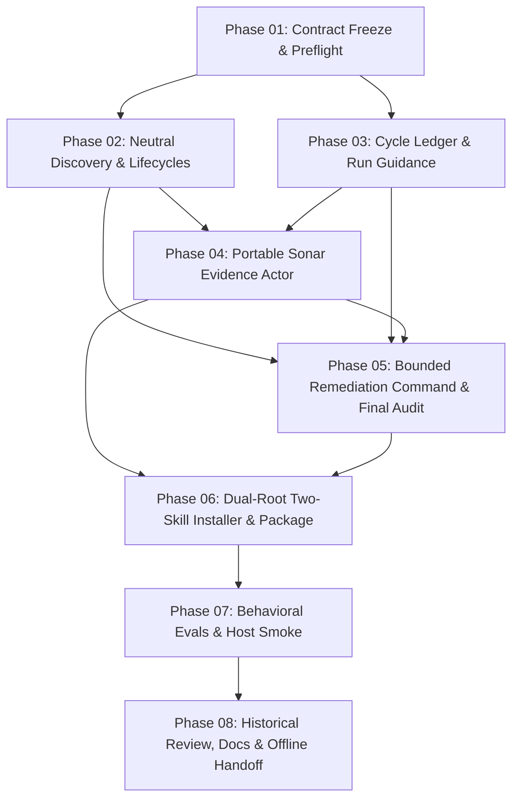

# Phase 01 Implementation Preflight Receipt

- Date: 2026-10-12
- Plan: General Sonar remediation cycles (`plans/261012-2156-general-sonar-remediation-cycles/plan.md`)
- Phase: Phase 01 — Contract freeze and capability preflight
- Status: Completed (100%) / Approved (2026-10-12)
- Workspace / Worktree: `/home/loidinh/WS/worktrees/evcrate-general-sonar-remediation-cycles`
- Branch: `feat/general-sonar-remediation-cycles` (base commit: `4dc038338b2bd5cd4b7ac3ac400e769e7d682bdf`)
- Integration Owner: Lead Engineer (Session Coordinator across all 8 phases)

---

## 1. Executive Summary & Objective

Phase 01 freezes shared implementation contracts, freezes proposed dual-root installed payload mappings (10 existing package assets + 8 proposed new assets across 18 destinations per root), discovers and records host delegation and behavioral evaluation mechanisms, and establishes strict boundaries between offline extension qualification and future consumer server-verified success. No installer modifications, native actor registrations, host configuration writes, or live network calls were performed in this preflight phase.

Core documentation review: `docs/system-architecture.md` was reviewed; its pre-existing proposed planning section (+27 lines) is verified accurate, self-contained with no links to ignored plans, and was left unchanged during Phase 01.

---

## 2. Shared Contract Freeze

### 2.1 Target Selection & CLI Contract
- Installer binary: `ext/sonarqube-test-quality/bin/install.js`.
- Target selector: extends existing `--target agents` to explicit `--target agents|claude|both`.
- Invariant: missing or unsupported target argument fails closed with an error. No default `both`; explicit `both` is strictly required to target both roots simultaneously.
- Directory parameter: `--directory <project>` remains mandatory.

### 2.2 Dual-Root Installed Payload Contract
- Single package source tree (`ext/sonarqube-test-quality/`) authored once; no duplicate source trees or host-specific command rewrites.
- Exact **18 proposed payload destinations and two entrypoints per selected root** (`36 destinations` for explicit `both`):

| Source Path (in extension) | Relative Destination Path (under selected root `R`) | Status / Category |
|---|---|---|
| `SKILL.md` | `skills/sonarqube-test-quality/SKILL.md` | Existing (Domain entrypoint 1) |
| `references/sonar-cli-commands.md` | `skills/sonarqube-test-quality/references/sonar-cli-commands.md` | Existing (Reference) |
| `references/full-scan-workflow.md` | `skills/sonarqube-test-quality/references/full-scan-workflow.md` | Existing (Reference) |
| `references/testing-and-coverage.md` | `skills/sonarqube-test-quality/references/testing-and-coverage.md` | Existing (Reference) |
| `references/remediation-and-handoff.md` | `skills/sonarqube-test-quality/references/remediation-and-handoff.md` | Existing (Reference) |
| `references/report-formats.md` | `skills/sonarqube-test-quality/references/report-formats.md` | Existing (Reference) |
| `references/worktree-remediation.md` | `skills/sonarqube-test-quality/references/worktree-remediation.md` | Existing (Reference) |
| `references/remediation-cycles.md` | `skills/sonarqube-test-quality/references/remediation-cycles.md` | Proposed Phase 02 (Reference) |
| `references/project-discovery.md` | `skills/sonarqube-test-quality/references/project-discovery.md` | Proposed Phase 02 (Reference) |
| `references/local-analysis.md` | `skills/sonarqube-test-quality/references/local-analysis.md` | Proposed Phase 02 (Reference) |
| `references/run-guidance.md` | `skills/sonarqube-test-quality/references/run-guidance.md` | Proposed Phase 03 (Reference) |
| `scripts/convert-sonar-report.mjs` | `skills/sonarqube-test-quality/scripts/convert-sonar-report.mjs` | Existing (Utility script) |
| `scripts/fetch-sonar-issues.ps1` | `skills/sonarqube-test-quality/scripts/fetch-sonar-issues.ps1` | Existing (PowerShell script) |
| `scripts/calculate-jacoco-coverage.ps1` | `skills/sonarqube-test-quality/scripts/calculate-jacoco-coverage.ps1` | Existing (PowerShell script) |
| `agents/sonar-evidence.md` | `skills/sonarqube-test-quality/agents/sonar-evidence.md` | Proposed Phase 04 (Portable prompt) |
| `templates/remediation-cycle-report.md` | `skills/sonarqube-test-quality/templates/remediation-cycle-report.md` | Proposed Phase 03 (Evidence template) |
| `templates/run-guidance-report.md` | `skills/sonarqube-test-quality/templates/run-guidance-report.md` | Proposed Phase 03 (Guidance template) |
| `commands/cmd-sonar-remediate/SKILL.md` | `skills/cmd-sonar-remediate/SKILL.md` | Proposed Phase 05 (Command entrypoint 2) |

- **Resolution Invariant:** Command-to-domain and domain-to-actor/reference links resolve strictly within that root from installed paths, never traversing into cwd, the parent git repository, or across roots.
- Packaged assets vs installed payload: `README.md`, `evals/`, `tests/`, and installation libraries (`lib/install.js`, `bin/install.js`) are npm package contents, NOT copied into the installed target roots.

### 2.3 Lock, Guard & Rollback Boundaries
- Transient project lock: `<project>/.sonarqube-test-quality.install.lock`.
- Legacy domain lock: `<project>/.agents/skills/sonarqube-test-quality/.install.lock` acquired whenever `agents` is selected.
- Acquisition ordering: acquire shared project lock first, then legacy agents lock.
- Lock release semantics: release only successfully owned locks in reverse order; in partial acquisition failure (e.g. legacy lock acquisition fails), release the owned project lock and preserve unowned lock objects. Pre-existing locks halt execution immediately with an informative message; no automatic stale lock deletion.
- Transaction boundary: one plan, stage, publish, verify, and caught-failure rollback spans all selected roots and sibling skills. Staging occurs beside each destination on its filesystem volume.
- Caught-failure rollback boundary: rollback handles caught filesystem/publication faults during copy/replacement. Replaced files are restored to their original bytes; owned additions, temporary staging files, and empty owned directories created by the transaction are removed; concurrently created or changed user content is strictly preserved.
- Rollback conflict reporting: any conflicts or restoration failures during rollback are reported explicitly as partial rollback with affected paths.
- Non-claims: no persistent database journal, no process crash recovery (SIGKILL/power loss), and no simultaneous atomic reader visibility guarantees across multiple processes.

### 2.4 Execution Profile & State Budget Contract
- Profile data model: stores repository checkout path, commit SHA, nonsecret configuration, and intended tracked/untracked build inputs. Never hashes secret-bearing files.
- Preserves unrelated uncommitted edits; no auto-stash, reset, or worktree creation unless explicitly requested by the user.
- Budget semantics: preflight baseline (C0) consumes 0 fix rounds. Entering Ck increments the persistent round counter before fixes start. Maximum $N$ is global across all targets. Incomplete or failed rounds consume the entered round. Maximum one corrective batch within Ck before requiring another round.
- Final revision (F): no free fix round. Requires aggregate review, separate user commit authorization, committed-input recheck, and final audit.

---

## 3. Host Capability & Subagent Discovery

### 3.1 Observed Host Environment
- **Platform:** Linux 7.1.10-200.fc44.x86_64
- **Runtime:** Node.js v24.16.0 on `$PATH` (satisfies Node `>=18.11.0` requirement)
- **Active Harness:** Observed `omp/18.10.2` on `$PATH` with native tool bindings

### 3.2 Subagent Delegation Mechanisms & Host Permissions
- **Generic Child Invocation:** In OMP, subagents are spawned synchronously via `task(context=..., tasks=[...])` and blocked/waited upon via the native `wait()` barrier.
- **Permission & Execution Model `[INFERENCE]`:** Inferred from OMP tool schema and session runtime context: OMP declares tools by capabilities (`task`, `bash`, `read`, `write`, `edit`); subagents execute in isolated sub-sessions with independent transcripts and return terminal reports.
- **Independent Roles Observed & Verified:**
  - `evc-tester`: Dedicated test execution, coverage calculation, and assertion verification (demonstrated live via `SonarTester`).
  - `evc-code-reviewer`: Independent code review covering architecture, security, performance, KISS/DRY/YAGNI, and validation results (demonstrated live via `SonarReviewer` and `SonarReviewer2`).
  - `task` child prompt loading `[INFERENCE]`: General child container proposed to load portable prompt compositions (e.g. `skills/sonarqube-test-quality/agents/sonar-evidence.md`, authored in Phase 04); empirical loading of this proposed prompt is unobserved, deferred to Phase 04/07.
- **Host Root Selection & Claude Prompt Composition `[INFERENCE]`:**
  - Cited from repository guidance (`.omp/evcrate/AGENTS.md:56`): OMP skill loading searches `.omp/skills/`, falling back to `~/.omp/agent/skills/` or `.agents/skills/`. Host loading from `.claude/skills/` or within Claude Code runtime is an inferred host behavior `[INFERENCE]`; empirical dual-root discovery and precedence observation is deferred to Phase 07 host smoke qualification.
  - Prompt-only loading without native actor registration (`.claude/agents/` untouched) is frozen by design contracts.
- **Independence Enforcement:** Reviewer and tester roles MUST use distinct identities from the implementation author. A self-authored review or test report is rejected.

### 3.3 Behavioral Evaluation Strategy
- **Asset Inventory:** Existing `ext/sonarqube-test-quality/evals/evals.json` contains 20 declarative prompt scenarios (ids 1–20). Currently, 14 scenarios (id 1 and 8–20) contain explicit prose `assertions`, while 6 scenarios (ids 2–7) contain `expected_output` only without `assertions` arrays. Phase 07 must author the missing prose assertions when revising the catalog for cycles.
- **Runner Capability Assessment:** No proprietary or custom evaluation runner binary exists in the repository.
- **Selected Mechanism:** Host-driven execution of labeled offline behavioral scenarios. Transcripts are captured verbatim and evaluated against explicit prose assertions and produced artifacts. Detailed evaluation grading rubrics and catalog expansion are deferred to Phase 07.
- **Execution Schedule:** Full offline behavioral qualification is deferred to Phase 07. Phase 01 confirms capability and records that lack of a real host runner in Phase 07 would constitute a release gate blocker, not permission to write a mock test runner.

---

## 4. Evidence Boundary: Historical Summary vs. Future Consumer Success

### 4.1 Preserved Historical Summary
- Preserved brainstorm source: `plans/reports/brainstorm-261012-2113-sonar-remediation-cycles.md` (archived at `reports/brainstorm-source.md`).
- Historical metrics: 56 tests executed, 46.48% line coverage, 63.91% branch coverage; latest focused change unanalyzed.
- Bound: These values represent historical procedural lessons (e.g. separate query vs scanner auth, paginated issue retrieval, hotspot review workflows, TLS requirements). They do **NOT** represent generic default thresholds, minimum coverage requirements for new projects, or runtime proof for this extension.

### 4.2 Offline Extension Qualification (What Completes the Extension)
- Consolidates 28 existing unit/integration tests (passing at baseline; Phase 06 additions will test dual-root installer and rollback).
- Adds packed dual-root installation, collision, rollback, and concurrency tests (Phase 06).
- Executes all required offline behavioral scenarios (current catalog 20, to be revised and expanded for cycle coverage in Phase 07).
- Conducts offline privacy review of sanitized guidance templates (Phase 08).
- **Explicit Non-Requirement:** No live SonarQube server, active API credentials, scanner upload, or remote task polling is required to qualify and merge this extension.

### 4.3 Future Consumer Server-Verified Success (Separate Consumer Prerequisite)
- When a consumer runs `cmd-sonar-remediate` against a live enterprise Sonar server, server-verified success requires:
  1. Approved real project configuration, toolchain, and analyzer credentials.
  2. Final analysis performed on committed intended inputs.
  3. Completed server analysis task with verified compute engine task status.
  4. Complete, consistent issue retrieval with 0 active in-scope issues.
  5. Satisfied quality gate conditions and completed hotspot reviews.
  6. Independent audit verification.
- Offline, synthetic, or historical evidence can never substitute for live consumer success.

---

## 5. Baseline Verification

Executed existing test suite in the designated worktree `/home/loidinh/WS/worktrees/evcrate-general-sonar-remediation-cycles`:

```bash
node --test ext/sonarqube-test-quality/tests/*.test.mjs
```

**Results (Baseline; Phase 06 additions not yet present):**
- Suites: 2 (`SonarQube common skill installer`, `full-field offline report conversion`)
- Total tests: 28
- Passed: 28 (100%)
- Failed: 0
- Skipped / Cancelled: 0
- Execution duration: ~1.1s

---

## 6. Phase Dependencies & Handoff Readiness



- **Phase 01:** Completed (100%, 2026-10-12); code review approved; Phase 02 and Phase 03 unblocked.
- **Phases 02 & 03:** May proceed in parallel or sequentially. Both must produce terminal results before Phase 04 and Phase 05 start.
- **Unresolved Questions:** None. All design contracts and scope boundaries are frozen.
