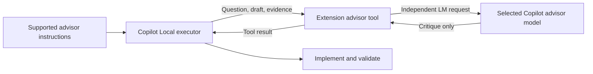

# Copilot Local advisor — research and brainstorm

Date: 2026-10-13
Status: research complete; direction agreed; implementation planning not requested.

## Decision

Build direction: a small VS Code extension contributing an advisor language-model tool to built-in **Local / Agent** chat, calling a user-selected Copilot-accessible model. Add supported instructions explaining when to consult it. Copilot remains executor.

User explicitly selected:
- Built-in Copilot Local, not a replacement participant or offline inference.
- Copilot model access, not separate provider credentials.
- Local advisor extension as the preferred direction.
- Research report only; no implementation plan or code changes.

This is a supported-API design recommendation, not an end-to-end runtime qualification. Do not market it as system-prompt replacement or a complete pi-advisor port.

## Problem and requirements

Bring the executor/advisor pattern from `/home/loidinh/WS/pi-advisor` into VS Code Local chat:
- Main model investigates, implements, and validates.
- Second model critiques consequential decisions, stalled work, or proposed completion.
- Main model receives the critique as a tool result and decides what to adopt.
- Existing Copilot access supplies the advisor; no additional provider key should be required.

### Artifact and acceptance for this research

Artifact: this Markdown report, with inspected local touchpoints, public implementation precedents, supported API boundaries, alternatives, recommendation, and future qualification criteria.

Acceptance:
1. Distinguish actual system-prompt mutation from additive instructions.
2. Identify public projects and classify their real fit; do not count replacement agents as Local extensions.
3. Check tool registration and second-model access against official docs/source.
4. Explain differences from pi-advisor, especially context and lifecycle access.
5. Record the user's selected direction without implementing or creating an implementation plan.

All five research criteria addressed. No extension installed, built, or exercised; no Copilot inference performed.

### Scope and constraints

In scope for the selected direction:
- Existing Local chat remains the user interface and executor.
- In-process VS Code language-model tool and Copilot model selection.
- Additive consultation instructions through supported customization mechanisms.
- Explicit, bounded review context; advisor has no editing or command-execution tools.

Not part of the selected design:
- Patching Copilot internals or replacing its base system prompt.
- Replacement chat participant, replacement coding agent, external model proxy.
- Assuming a Copilot subscription grants every model or unlimited/free advisor requests.
- Assuming full Pi/OMP lifecycle, transcript reconstruction, accounting, or gate parity.

Compatibility constraint: use public stable APIs for the extension's core. Exact minimum VS Code/Copilot versions and distribution target require later qualification. No timeline or performance SLA was supplied.

## Local implementation evidence

### pi-advisor

Inspected package version: `pi-advisor-flow` 0.13.0; package declares MIT licensing.

| Source | Relevant behavior | Port implication |
|---|---|---|
| `src/tools/register-lifecycle.ts:121-193` | Constructs invocation rules and mutates `before_agent_start` system-prompt sections or appends owned prompt blocks | Host-specific; no equivalent public base-prompt mutation API established for Copilot Local |
| `src/tools/register-ask-advisor.ts:134-179` | Registers `ask_advisor`, checks model access, handles follow-ups and consultation budgets | Tool concept transfers; host registration/session contracts do not |
| `src/tools/consultation.ts:182-229` | Assembles conversation, draft, repository changes, rules, files, images, and redaction into a request | Copilot tool needs an explicit context contract rather than assuming access to Pi session history |
| `src/tools/prompts.ts:44-75,152-192` | Treats supplied drafts as unverified claims; advisor critiques without taking over; configurable invocation guidance | Reuse design principles and suitable prompt content with license attribution; avoid importing Pi runtime dependencies |
| `README.md:36-44` | Normal consultation is advisory; automatic loop gates are a distinct behavior | Do not conflate suggested consultation with enforced gating |

### Existing EVCrate integration

- `README.md:153-180`: existing `.evcrate-vscode` Agent Plugins bundle, native lifecycle hooks, and private model-binding companion.
- `extensions/vscode-model-bindings/package.json:15-17`: existing companion enables proposed `chatPromptFiles`.
- `extensions/vscode-model-bindings/src/model-catalog.ts:145-153`: existing model catalog calls `selectChatModels`, then filters for tool-calling capability when that metadata is available.
- `docs/system-architecture.md:537-540`: existing qualification is candidate-bound; model-binding diagnostics are not proof of live inference.

Implications:
- Existing plugin delivery could distribute advisor instructions later; do not invent another EVCrate instruction authority.
- A tool-free advisor does not require tool-calling model capability. Do not blindly reuse the existing agent-model filter.
- Keep a public stable advisor extension independent of the companion's proposed API requirement. Whether it belongs in this repository or a standalone repository remains undecided.
- No existing EVCrate files were modified except adding this requested report.

## Public implementations and precedents

### 1. GitHub Copilot Rubber Duck — closest behavior, different harness

Sources:
- [Official Rubber Duck documentation](https://docs.github.com/en/copilot/concepts/agents/copilot-cli/rubber-duck)
- [VS Code integration test-plan issue #319092](https://github.com/microsoft/vscode/issues/319092)

Documented behavior:
- Built-in critic uses a different model from the session's executor.
- Reviews plans, implementation, and tests; reports actionable severity-ranked findings.
- Read-only exploration; executor decides whether to adopt feedback.
- Manual `/rubber-duck` and optional proactive invocation.

Fit: close behavioral precedent for the proposed product. Not a verified drop-in for **Local**. The official page describes Copilot CLI; the VS Code issue explicitly concerns Agent Host / Copilot CLI and `chat.agentHost.rubberDuck.enabled`.

Caution: a closed test-plan issue is not a successful runtime receipt. Its comments include unsuccessful early tests. Do not infer current Local support or guaranteed availability from that issue.

### 2. Microsoft VS Code extension samples — correct tool integration foundation

Sources:
- [chat-sample repository directory](https://github.com/microsoft/vscode-extension-samples/tree/main/chat-sample)
- [src/tools.ts](https://github.com/microsoft/vscode-extension-samples/blob/main/chat-sample/src/tools.ts)

Verified source: `registerChatTools`, `vscode.lm.registerTool`, `LanguageModelTool.invoke`, `prepareInvocation`, and `LanguageModelToolResult`.

Fit: public implementation of tools callable from built-in agent chat. It demonstrates utility tools, not a finished second-opinion product. Combine this integration pattern with the documented LM request API, not the sample's separate chat persona.

### 3. Cline — model-access adapter reference, not a Local advisor

Sources:
- [Cline repository](https://github.com/cline/cline)
- [vscode-lm-handler.ts](https://github.com/cline/cline/blob/main/apps/vscode/src/sdk/vscode-lm/vscode-lm-handler.ts)

Verified source: `VsCodeLmHandler.getClient()` selects a model through `vscode.lm.selectChatModels`; `createMessage()` calls `client.sendRequest`, handles streaming and cancellation.

Fit: implementation evidence for using the VS Code model provider from an extension. Cline is a separate executor, not a tool inside built-in Copilot Local. Its formatting and approximate usage conventions are not automatically suitable for the advisor design.

### 4. PAL MCP, formerly Zen — reusable multi-model backend pattern

Source: [BeehiveInnovations/pal-mcp-server](https://github.com/BeehiveInnovations/pal-mcp-server).

Public implementation offers consultation, review, consensus, conversation continuation, and CLI delegation. README setup uses provider credentials or local models.

Fit: relevant workflow and MCP precedent, but not direct reuse of Copilot's in-process `vscode.lm`. A plain external MCP process cannot call that VS Code API. A bridge could add access but also adds another service, security boundary, and maintenance burden; not recommended for this request.

### 5. OpenCode Second Opinion — advisor prompt/workflow reference

Source: [1183029827/opencode-second-opinion](https://github.com/1183029827/opencode-second-opinion).

Public MIT project provides controller/advisor roles, different-model-family advice, `decide` / `review` / `discuss` modes, and restricted subagent permissions.

Fit: useful prompt and role-separation reference. Targets OpenCode, not VS Code Copilot Local.

### Search conclusion

The executor/advisor pattern is already implemented publicly. No dedicated, source-verified, drop-in extension matching **Local chat + Copilot-backed advisor + pi-advisor-like guidance** was found in this research. This is a bounded search result, not proof that no such repository exists.

## API feasibility and hard boundaries

### Supported core

Official guides:
- [Language Model Tool API](https://code.visualstudio.com/api/extension-guides/ai/tools)
- [Language Model API](https://code.visualstudio.com/api/extension-guides/ai/language-model)

The extension can:
1. Declare a tool in `contributes.languageModelTools`.
2. Register its implementation with `vscode.lm.registerTool`.
3. Enumerate Copilot models with `vscode.lm.selectChatModels({ vendor: 'copilot' })`.
4. Send a separately constructed review request through the selected model's `sendRequest`.
5. Return the critique through `LanguageModelToolResult` into the executor's existing conversation.

Consent: LM access requires user authorization. Use an explicit setup/model-selection command for initial consent; do not assume autonomous first invocation can silently authorize access. Tool approval and model authorization are separate concerns.

Availability: enumerate available models instead of hardcoding model examples from documentation. An empty model list, denied consent, unavailable selected model, quota exhaustion, cancellation, or stream failure must be reported honestly. No silent substitution of the advisor model.

### “System prompt injection” is not the supported contract

- No supported public API identified for replacing/modifying built-in Copilot Local's base system prompt.
- Custom-agent bodies are prepended to the user chat prompt according to [custom-agent documentation](https://code.visualstudio.com/docs/agent-customization/custom-agents).
- Stable LM API supports User and Assistant messages, not System messages. Advisor role instructions can be supplied as an initial User message.
- [VS Code extension-host source](https://github.com/microsoft/vscode/blob/main/src/vs/workbench/api/common/extHostLanguageModels.ts) checks proposed `languageModelSystem` before accepting a System role. Even that proposal concerns the extension's own model request, not rewriting the executor's prompt.

Correct product wording: **add advisor instructions/context**, not **override Copilot system prompt**.

### Transcript/context access

Language-model tool invocation supplies structured inputs, not the parent conversation history. `toolInvocationToken` is opaque; not a transcript API or credential for the LM request.

Recommended context: original objective, constraints, candidate plan/patch, known failures, and actual verification evidence. Optional repository evidence collection must be user-authorized, bounded, and distinguish collected evidence from executor claims.

[Local hooks reference](https://code.visualstudio.com/docs/agents/reference/hooks-reference) documents an optional `transcript_path`, but explicitly states that its file format is not a stable hook API. Do not make transcript scraping a requirement of the stable extension.

Hooks can add context or control execution at documented lifecycle points. In particular, `SessionStart` supports `additionalContext`; `PreToolUse` can allow/deny/ask and add context; `Stop` can require continued work. These are not base-prompt mutation. Hook `systemMessage` is a warning shown to the user, not a system-role prompt injection field.

### Native subagent limitation

[Official Local subagent docs](https://code.visualstudio.com/docs/agents/run/subagents) state:
- No automatic inheritance of main conversation history.
- Each Local invocation is stateless; follow-up needs a fresh invocation.
- Explicit or agent-configured advisor model selection is checked against the executor's cost tier; higher-tier selection is rejected.

This can defeat the cheap-executor/strong-advisor pattern.

The inspected extension-host LM request path is independent of that subagent session selection path. No parent-tier check was observed in the inspected path. This supports choosing the extension route, but does **not** establish that a particular frontier model will be available under the user's account. Live model-pair qualification remains required; do not promise a billing or policy bypass.

## Evaluated approaches

| Approach | Advantages | Limits | Decision |
|---|---|---|---|
| Native Local advisor custom agent | Minimal code; host manages delegation and model calls | Cost-tier ceiling; stateless; explicit context handoff; no Pi-style lifecycle parity | Viable restricted alternative, not selected |
| VS Code LM tool + supported instructions | Keeps Local executor; uses Copilot provider; explicit context and tool-free reviewer; stable core APIs | Extension maintenance; consent/quota handling; no automatic transcript; prompt compliance is probabilistic | Selected |
| Existing Rubber Duck | Closest ready-made behavior; no custom tool implementation | Requires changing to documented CLI/Agent Host surface; different customization contract; availability must be checked | Not selected because user chose Local |

MCP and replacement chat participants are integration alternatives, but add complexity or change the required surface without improving the selected credential path.

## Recommended architecture

Design properties:
- Advisor returns critique; no tools supplied to its request, no edits, no nested agent loop.
- User selects advisor model explicitly. Do not assume the tool knows the executor's active model from its invocation parameters.
- Instructions recommend consultation at high-value decisions, repeated failures, or review points. They do not establish deterministic mandatory gates.
- Bound context and reply sizes; label omitted evidence and incomplete context.
- Treat repository content and executor claims as untrusted review material. Do not claim secret redaction is perfect or that Local means offline/private inference.
- Preserve the executor's authority to evaluate/reject advice and verify results.

Do not port Pi-specific session management, terminal UI, automatic loop gates, follow-up caches, outcome ledgers, Scout, or provider fallback machinery merely because they exist upstream. Any requested parity item needs an explicit future requirement.

## Future observable acceptance criteria

These are qualification criteria for a later implementation, not checks performed during this research:

1. Install the extension on an agreed stable VS Code/Copilot tuple without proposed-API launch flags for the advisor core.
2. Authorize access through a user action; enumerate and select an available Copilot advisor model without extra provider keys.
3. From a real Local Agent session, invoke the advisor tool and observe the selected second model's response returned into the same executor conversation.
4. Exercise the intended executor/advisor pair, including any lower-cost executor/higher-cost advisor combination; record actual availability and quota behavior.
5. Use a candidate with a known substantive defect; the advisor receives sufficient evidence and returns a review, while the executor retains responsibility for edits and checks. Do not rely on identical model wording as acceptance.
6. Advisor request supplies no editing, terminal, or recursive consultation tools.
7. Denied consent, disabled tool, missing model, cancellation, and request failure remain visible; none is represented as a successful review.
8. Inspect the disclosed context and confirm that only approved evidence is sent; no transcript scraping or silent whole-workspace upload.
9. Confirm guidance is present through the chosen supported instruction mechanism. Measure invocation behavior separately from tool correctness; do not claim guaranteed automatic consultation from prompt wording.

Metrics: correct model selection, successful same-chat return, truthful error states, disclosed-context bounds, consultation latency, and observed request consumption. No latency/cost target agreed yet.

## Risks and dependencies

- Public docs and source branches move; pin host/API versions during later qualification.
- Model access differs by subscription and organizational policy. Copilot access does not mean no additional quota consumption.
- A second model can agree incorrectly; review is not verification, and a different family does not guarantee independence.
- Executor-provided summaries can omit decisive evidence. Context quality is part of product behavior.
- Stronger automatic gates require documented hook integration, session correlation, bounded continuation, and their own acceptance criteria; not implied by the selected tool architecture.
- Public Marketplace distribution should not inherit the existing EVCrate companion's proposed-API dependency.

## Research validation

- Inspected local pi-advisor source and existing EVCrate Local/model-binding touchpoints.
- Consulted two research agents; collected both terminal reports, then checked important claims against primary documentation/source.
- Independently verified Rubber Duck's CLI/Agent Host scope rather than treating it as an exact Local match.
- Read public sample tool code, Cline LM adapter, PAL README, OpenCode advisor workflow, and official tool/model/subagent/hook docs.
- Documentation discovery helper returned no Context7 match; used its documented web/official-source fallback.
- No code implementation, tests, extension-host run, or authenticated model request. Feasibility is documentation/source evidence only.

## Next steps and unresolved questions

User chose to stop at research. No implementation plan created.

Before a later plan:
1. Standalone extension/repository or EVCrate-owned distribution? Private VSIX or public Marketplace?
2. Best-effort automatic consultation, explicit invocation, or enforceable review gates?
3. Which context may be collected beyond executor-supplied arguments: selected files, Git patch, hook event evidence?
4. Exact supported host versions/platforms and acceptable latency/usage limits?
5. Which executor/advisor model pair is available and authorized on the target account?

None blocks this research deliverable; all constrain a future implementation contract.
